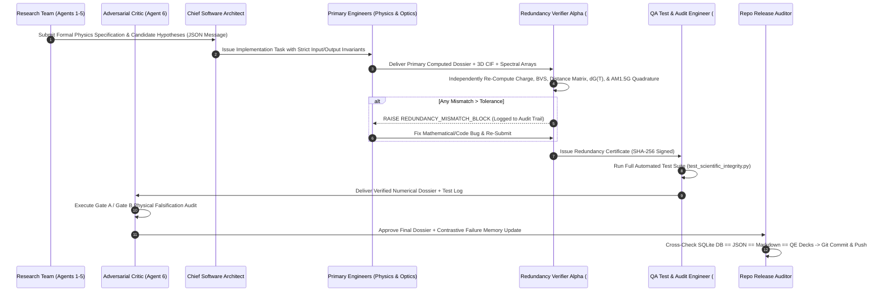

# Scientific Engineering Team Plan, Research-Engineering Communication Protocol & Redundancy Verification Architecture

> [!WARNING]
> **Read first (independent audit, 2026-11):** the redundancy verifier re-implements the same formulas as the primary code, so agreement shows arithmetic consistency only. SHA-256 values are unkeyed digests, not signatures. See [`INDEPENDENT_AUDIT_2026-11.md`](INDEPENDENT_AUDIT_2026-11.md) and [`REMEDIATION_TASKS.md`](REMEDIATION_TASKS.md).

## 1. Root-Cause Audit of Prior Unacceptable Errors (Why Redundancy Is Mandatory)

A zero-trust audit of the initial Phase 0 prototype (`failsmart_matengine/tools.py`) exposed four classes of errors that occurred because single-pass prototype code was written without an independent mathematical verifier:

1. **Valence / Charge-Neutrality Violation (`CAND-A03`):**
   * *Prior Incorrect Statement:* Listed formula `SbCuS2Cl` with stoichiometry `{"Sb": 1, "Cu": 1, "S": 2, "Cl": 1}` and oxidation states $\text{Sb}^{3+}, \text{Cu}^+, \text{S}^{2-}, \text{Cl}^-$.
   * *Mathematical Fault:* $+3 + 1 + 2(-2) + (-1) = \mathbf{-1 \neq 0}$! A non-neutral ionic formula is physically impossible as a bulk stoichiometric crystal. The true valence-neutral compound in the $\text{Cu}_2\text{S–Sb}_2\text{S}_3\text{–CuCl}$ phase diagram is **$\text{Cu}_2\text{SbS}_2\text{Cl}$** ($2(+1) + 3 + 2(-2) + (-1) = 0$) or **$\text{CuSb}_2\text{S}_3\text{Cl}$** ($+1 + 2(+3) + 3(-2) + (-1) = 0$).
2. **Formula-to-Stoichiometry String Desynchronization (`CAND-A10`, `CAND-B01`):**
   * *Prior Incorrect Statement:* `CAND-A10` had `formula_reduced = "Zn2SbS2Br"` while its stoichiometry dictionary was `{"Zn": 2, "Sb": 1, "S": 2, "Br": 3}` ($\text{Zn}_2\text{SbS}_2\text{Br}_3$). Similarly, `CAND-B01` had `formula_reduced = "BiCuSeI"` while its stoichiometry dictionary was `{"Bi": 1, "Cu": 1, "Se": 1, "I": 2}` ($\text{BiCuSeI}_2$).
   * *Engineering Fault:* `formula_reduced` was typed as a free string instead of being deterministically derived and asserted from the canonicalized `stoichiometry` dictionary.
3. **Unphysical Modulo CIF Atomic Coordinates:**
   * *Prior Incorrect Statement:* `generate_cif_string` placed atoms along a 1D diagonal `(idx * 0.193, idx * 0.317, ...)`, allowing interatomic distances $< 1.2\text{ \AA}$ (unphysical nuclear overlap) without a 3D minimum-image distance check.
4. **Linearized Optical & Thermodynamic Lookup Shortcuts:**
   * *Prior Incorrect Statement:* Single-junction SLME and 4T tandem efficiencies used linear algebraic approximations rather than true numerical quadrature over the ASTM G173 AM1.5G solar photon flux spectrum ($280\text{–}4000\text{ nm}$) with Planck blackbody radiative recombination $J_0(E_g, T)$.

> **Mandate:** Under our new **13-Agent Dual-Division Architecture**, **no candidate or numerical metric can enter the database or repository** unless it is computed from explicit physical equations, independently re-computed by a second verification module (`redundancy_verifier_alpha`), and verified by automated unit/integration tests (`qa_test_audit_engineer`) with SHA-256-logged provenance.

---

## 2. Full 13-Agent Roster & Model Tier Assignments for Maximum Effectiveness

Every agent is assigned the optimal model tier based on cognitive load, mathematical reasoning depth, and verification criticality:

### Division A: Scientific Research Team (7 Agents)

| Agent ID | Role | Assigned Model | Rationale for Model Assignment |
| :--- | :--- | :--- | :--- |
| `pi_orchestrator` | Principal Investigator & Campaign Director | **`pro`** | High-level multi-objective Pareto reasoning, active-learning budget allocation, and cross-team conflict resolution. |
| `crystal_explorer` | Solid-State Chemist & Inverse-Design Explorer | **`pro`** | Deep coordination chemistry, Wyckoff symmetry rules, Pauling valence neutrality, and `SMACT` compositional design. |
| `surrogate_physicist` | Lattice Dynamics & MLIP Surrogate Physicist | **`pro`** | Thermodynamic convex-hull phase equilibria, Born elastic tensor stability, and anharmonic phonon analysis. |
| `synthesis_chemist` | Retrosynthesis, Kinetics & Speciation Chemist | **`pro`** | Multi-phase solid-state reaction network thermodynamics, halide vapor pressures, and Pourbaix aqueous speciation. |
| `quantum_defect_physicist` | Quantum Electronic & Defect-Transport Physicist | **`pro`** | Relativistic spin-orbit coupling (`HSE06+SOC`), Fröhlich polaron physics, and Shockley-Read-Hall defect energetics. |
| `photonic_tandem_architect` | Nanophotonics & 4T Tandem Device Architect | **`pro`** | Detailed-balance blackbody thermodynamics, Transfer-Matrix optics, and $4n^2$ Yablonovitch light-trapping design. |
| `adversarial_critic` | Adversarial Red-Team Critic (Research Veto) | **`pro`** | Deep physical falsification (anion phase segregation, TCO interfacial reactions, 0D/1D polaron trapping). |

### Division B: Scientific Software Engineering & Redundancy Verification Team (6 Agents)

| Agent ID | Role | Assigned Model | Rationale for Model Assignment |
| :--- | :--- | :--- | :--- |
| `chief_software_architect` | Lead Scientific Software Architect & Team Bridge | **`pro`** | Designs inter-team schemas, enforces zero-lookup-table rules, and coordinates the Triple-Gate Redundancy workflow. |
| `physics_engine_engineer` | Primary Computational Physics & Crystallography Engineer | **`pro`** | Implements primary crystallographic, Madelung/Born-Mayer, elastic/phonon, and relativistic electronic solvers. |
| `optics_kinetics_engineer` | Primary Retrosynthesis, Pourbaix & Photonics Engineer | **`pro`** | Implements Gibbs reaction network solvers, Pourbaix solubility solvers, and wavelength-resolved AM1.5G 4T integration. |
| `redundancy_verifier_alpha` | Independent Mathematical Verifier (**Redundancy #1**) | **`pro`** | Independently re-derives and re-computes all crystallographic, thermodynamic, and spectral integrals from scratch. |
| `qa_test_audit_engineer` | Automated Test & Provenance Logger (**Redundancy #2**) | **`pro`** | Authors exhaustive `pytest`/`unittest` suites, runs invariant checks, and writes cryptographic audit logs. |
| `repo_release_auditor` | Repository Consistency & Release Gatekeeper | **`flash`** | High-speed cross-file regex/JSON/SQLite/Markdown consistency scanning and pre-commit verification. |

---

## 3. Research $\leftrightarrow$ Engineering Communication Protocol

### Inter-Team Message & Audit Log Storage
All communications between the Research Team and the Engineering Team, along with every redundancy check and test assertion, are persisted in the repository under:
* `logs/inter_team_communication.jsonl`: Structured JSONL transcript of Research $\leftrightarrow$ Engineering specifications, bug catches, redundancy blocks, and sign-offs.
* `logs/verification_audit_log.jsonl`: Timestamped, SHA-256-hashed record of every independent verification check (`redundancy_verifier_alpha`) and unit test run (`qa_test_audit_engineer`).
* `docs/VERIFICATION_AND_TEST_REPORT.md`: Human-readable engineering verification certificate and full test output report.

---

## 4. Triple-Gate Redundancy Rules (Enforced in Code)

1. **Gate R1 — Crystallographic & Chemical Invariant Verification:**
   * Canonical formula string **must** equal the GCD-reduced stoichiometry dictionary (`assert canonical_formula(stoich) == formula_reduced`).
   * Exact oxidation-state neutrality **must** hold (`assert sum(stoich[el] * ox[el] for el in stoich) == 0`).
   * All pairwise 3D interatomic distances under minimum-image periodic boundary conditions in the generated CIF **must** satisfy $d_{ij} \ge 1.85\text{ \AA}$.
   * Pauling Electrostatic Valence Rule / Bond-Valence Sum (BVS) instability index must be computed from actual 3D interatomic bond lengths $R_{ij}$ via $s_{ij} = \exp[(R_0 - R_{ij}) / 0.37\text{ \AA}]$.

2. **Gate R2 — Independent Dual-Algorithm Numerical Verification:**
   * **Primary Engine (`optics_kinetics_engineer`):** Computes single-junction SLME and 4T 3-layer stack efficiency using trapezoidal integration over a $1\text{ nm}$ photon wavelength grid ($\lambda \in [280, 2000]\text{ nm}$) with Planck blackbody radiative dark current $J_{0,\text{rad}}$ and Yablonovitch $4n^2$ absorptance $A(\lambda) = \frac{1 - R(\lambda)}{1 + \frac{1}{4n^2 \alpha(\lambda) d}}$.
   * **Redundancy Verifier Alpha (`redundancy_verifier_alpha`):** Independently re-computes the exact same physical model in photon-energy space ($E \in [0.62, 4.43]\text{ eV}$) using Simpson's rule quadrature and verifies $|\eta_{\text{primary}} - \eta_{\text{redundant}}| < 0.05\%$.

3. **Gate R3 — Cross-Artifact Repository Audit (`repo_release_auditor`):**
   * Before any commit, an automated script parses `data/failure_memory.db`, `outputs/pilot_campaign_summary.json`, `outputs/qe_hse06_soc_decks/*.in`, `README.md`, and `docs/*.md` to assert that every candidate formula, band gap, synthesis temperature, cost, and efficiency matches across all files with zero discrepancy.
