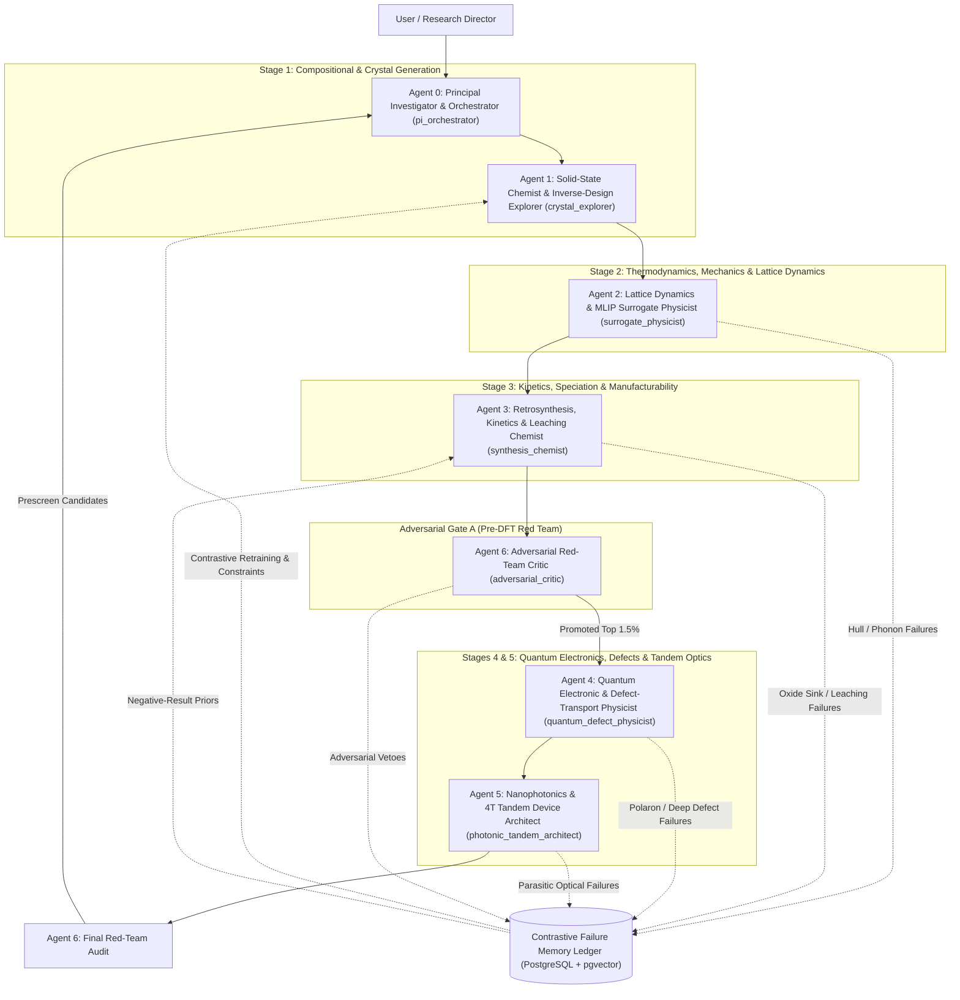

# FailSmart-MatEngine: Expert Scientific Team & Implementation Plan

> [!WARNING]
> **Read first (independent audit, 2026-11):** this file is a design target. None of the heavy tools it names (MatterGen, MACE/CHGNet, phonopy, rxn_network, Quantum ESPRESSO, doped, LangGraph — all not run) is invoked by the code; the reported counts and efficiencies come from heuristic stand-ins. See [`INDEPENDENT_AUDIT_2026-11.md`](INDEPENDENT_AUDIT_2026-11.md) and [`REMEDIATION_TASKS.md`](REMEDIATION_TASKS.md).

> [!IMPORTANT]
> **Mission Objective:** Discover, stress-test, and prescreen earth-abundant, phase-stable, defect-tolerant **inorganic chalcohalide and oxychalcogenide semiconductors** ($\text{Bi/Sb–Cu/Zn/Sn–S/Se/O–Cl/Br/I}$) for a **mechanically decoupled (4-Terminal) 3-Layer "Silicon-Sandwich" Photovoltaic Stack**:
> 1. **Top "Active Glass" Layer ($E_g \in [1.75, 1.95]\text{ eV}$):** Coated directly on soda-lime cover glass ($T_{\text{synth}} \le 500^\circ\text{C}$), harvesting UV/blue/green photons while transmitting $>85\%$ of red/IR light ($>670\text{ nm}$).
> 2. **Middle Anchor ($E_g = 1.12\text{ eV}$):** Off-the-shelf commercial bifacial crystalline silicon wafer.
> 3. **Bottom IR Scavenger ($E_g \in [0.70, 0.85]\text{ eV}$):** Decoupled narrow-gap thin film beneath silicon with a textured rear mirror for $4n^2$ Yablonovitch Total Internal Reflection, harvesting $1100\text{–}1750\text{ nm}$ sub-bandgap infrared photons.

---

## 1. Scientific Blind Spots Resolved Beyond the Initial Concept

Before locking in the agent roster, four deep physical failure modes specific to heavy lone-pair ($ns^2$) chalcohalides and 4T tandem stacks must be built directly into the team's mandate:

1. **Relativistic Spin-Orbit Coupling (SOC) is Non-Negotiable:** Heavy pnictogen/post-transition cations ($\text{Bi}^{3+}, \text{Sb}^{3+}, \text{Sn}^{2+}$) and heavy halides/chalcogenides ($\text{I}^-, \text{Br}^-, \text{Se}^{2-}$) exhibit giant spin-orbit splitting ($0.3\text{–}0.8\text{ eV}$) at the conduction/valence band edges. Standard HSE06 without SOC overestimates band gaps by up to $0.5\text{ eV}$ and misidentifies direct vs. indirect transitions (design target; HSE06+SOC not run in current code).
2. **The "Bi-Halide Polaron Trap" (Electronic Dimensionality & Carrier Transport):** Many $\text{Bi/Sb}$ halides pass band-gap and defect-tolerance checks yet fail in solar cells (<2% efficiency) because 0D/1D crystal connectivity yields flat bands ($m^* > 1.5\,m_0$) and **self-trapped small polarons**—carriers freeze in local lattice distortions before traversing a $300\text{ nm}$ film. We must enforce 3D/quasi-2D electronic dimensionality, low effective masses ($m_e^*, m_h^* < 0.5\,m_0$), high static dielectric screening ($\varepsilon_0 > 15$), and Fröhlich large-polaron criteria.
3. **Volatile Halide Precursor Loss Under $500^\circ\text{C}$:** Binary metal halides ($\text{BiCl}_3, \text{SbI}_3, \text{SnI}_4$) sublimate or hydrolyze between $150^\circ\text{C}$ and $350^\circ\text{C}$. Retrosynthesis cannot merely check solid-state $\Delta G_{\text{rxn}}$; it must track vapor-phase chemical potentials and favor nonvolatile oxyhalide/sulfide intermediate pathways or solution-complexed routes.
4. **Full-Stack Optical & Parasitic Coupling:** A top absorber with high single-layer SLME is useless if high refractive-index mismatch ($R(\lambda)$) or sub-bandgap tail absorption starves the underlying $1.12\text{ eV}$ silicon wafer. Every candidate must be evaluated inside an optical Transfer-Matrix Method (`TMM`) + $4n^2$ light-trapping stack across all three junctions.

---

## 2. The Expert Scientific Team Roster (7 Agents)

Rather than generic LLM personas, each agent is a **domain-specialized state-machine node** bound to deterministic computational physics tools, hard falsification metrics, and explicit input/output schemas.



### Agent 0: Principal Investigator & Campaign Orchestrator (`pi_orchestrator`)
* **Scientific Persona:** Senior Computational Materials Director & Systems Architect.
* **Core Mandate:** Manages campaign state in `LangGraph`, enforces the compute budget cap (\$1,000/sweep), balances exploration between the **Top Active Glass (1.85 eV)** and **Bottom IR Scavenger (0.75 eV)** tracks, and maintains the Pareto frontier across efficiency, synthesizability, and \$/W cost.
* **Deterministic Tools:** Campaign state ledger, multi-objective Pareto optimizer (`botorch` / `pymoo`), epistemic uncertainty router (triggers DFT when 4-model MLIP force std $\sigma_F > 0.15\text{ eV/\AA}$ on otherwise top-ranked motifs).

### Agent 1: Solid-State Chemist & Inverse-Design Explorer (`crystal_explorer`)
* **Scientific Persona:** Inorganic Crystallographer & Generative ML Specialist.
* **Core Mandate:** Translates the 3-Tier Element Policy and target electronic rules ($ns^2$ lone-pair cations $\text{Bi}^{3+}, \text{Sb}^{3+}, \text{Sn}^{2+}$ paired with $\text{Cu}^+, \text{Zn}^{2+}, \text{Ba}^{2+}, \text{Sr}^{2+}$ and mixed anions $\text{S}^{2-}, \text{Se}^{2-}, \text{O}^{2-}, \text{Cl}^-, \text{Br}^-, \text{I}^-$) into charge-neutral, Pauling-rule-compliant compositions and 3D unit cells ($\le 32$ atoms/cell).
* **Deterministic Tools:**
  * `SMACT` (Semiconducting Materials by Analogy and Chemical Theory) for oxidation-state neutrality, Pauling electronegativity, and Goldschmidt/octahedral tolerance pre-screening.
  * `MatterGen` (SE(3)-equivariant diffusion with property adapters) + wyckoff-symmetry template substitution (`pyxtal`).
  * `pymatgen` local coordination & bond-valence sum (`BVAnalyzer`) sanity filters (rejects unphysical interatomic distances $< 1.6\text{ \AA}$ before wasting GPU cycles).

### Agent 2: Lattice Dynamics & MLIP Surrogate Physicist (`surrogate_physicist`)
* **Scientific Persona:** Statistical & Condensed Matter Physicist (Thermodynamics & Phonons).
* **Core Mandate:** Evaluates $0\text{ K}$ and finite-temperature ($300\text{–}800\text{ K}$) structural, mechanical, and dynamical stability using an ensemble of universal machine-learning interatomic potentials.
* **Deterministic Tools:**
  * **4-Member MLIP Ensemble (`MACE-OMat24` + `CHGNet`; design target, not run):** Full cell + atomic position relaxation (`FIRE` / `BFGS` via `ASE`) plus force-variance epistemic uncertainty ($\sigma_F$).
  * **Thermodynamic Hull Engine (`pymatgen.analysis.phase_diagram`):** Queries synchronized Materials Project + Alexandria convex hulls (with `MaterialsProject2020Compatibility` corrections). **Hard Gate:** $\Delta E_{\text{hull}} \le 50\text{ meV/atom}$ (or stabilized at $T_{\text{synth}}$ via vibrational/configurational entropy $\Delta G_{\text{hull}}(T) \le 0$).
  * **Dynamic & Mechanical Stability (`phonopy` + `matcalc`):** Finite-displacement supercell phonon spectra and elastic stiffness tensor $C_{ij}$. **Hard Gates:** Rejects imaginary phonon modes ($\omega < -0.5\text{ THz}$ anywhere in the Brillouin zone), checks Born elastic stability ($C_{ij}$ eigenvalues $> 0$), and computes Debye temperature $\Theta_D$ and lattice thermal conductivity proxy.

### Agent 3: Retrosynthesis, Kinetics & Environmental Speciation Chemist (`synthesis_chemist`)
* **Scientific Persona:** Experimental Solid-State Chemist & Geochemical Speciation Expert.
* **Core Mandate:** Guarantees that surviving crystals can actually be synthesized below the **$500^\circ\text{C}$ soda-lime glass ceiling** without collapsing into dead binary/oxide impurity sinks, losing volatile halides, or leaching toxic ions in rainwater.
* **Deterministic Tools:**
  * **Reaction Network & Impurity Sink Simulator (`rxn_network` + LBNL 80k Impurity Dataset):** Constructs grand-potential reaction graphs from commercial precursors ($\text{Bi}_2\text{O}_3, \text{Bi}_2\text{S}_3, \text{BiCl}_3, \text{Cu}_2\text{S}, \text{ZnS}$, etc.) at $T \in [300, 773]\text{ K}$. Computes reaction driving force $\Delta G_{\text{rxn}}$ vs. parasitic competing sinks (e.g., $\text{ZrO}_2, \text{TiO}_2, \text{BiOCl}$).
  * **Contrastive Synthesizability Scorer (`PU-CGCNN` + Impurity Margin Classifier):** Scores crystal synthesizability trained on ICSD positives vs. documented LBNL impurity-phase failures.
  * **Aqueous Leaching & Environmental Gate (`pymatgen` `PourbaixDiagram`):** Evaluates aqueous stability across $\text{pH } 4\text{–}9$ (acid rain to groundwater) and redox potentials $E_h \in [-0.2, +0.8]\text{ V}$. **Hard Gate:** Any Tier 2 element ($\text{Pb, Cd, Se, Sb, In, Ag, Te}$) must remain locked in solid phases ($\Delta G_{\text{pbx}} \le 0.1\text{ eV/atom}$, dissolved concentration $< 10^{-6}\text{ M}$) and cost $< \$0.50/\text{m}^2$ at target optical thickness.

### Agent 4: Quantum Electronic Structure & Defect-Transport Physicist (`quantum_defect_physicist`)
* **Scientific Persona:** Ab Initio Electronic Structure & Semiconductor Defect Theorist.
* **Core Mandate:** Executes high-fidelity open-source DFT (`Quantum ESPRESSO`) on the top $1.5\%$ of Stage 3 survivors to verify true relativistic band gaps, carrier transport, polaron localization, and intrinsic defect tolerance.
* **Deterministic Tools:**
  * **Automated DFT Engine (`atomate2` + `custodian` + `Quantum ESPRESSO` GPU; design target, not run):**
    * *Step 4a (Fast Meta-GGA Screen; not run):* `r2SCAN + SOC` electronic band structure and density of states (DOS) to check orbital hybridization ($ns^2$ cation $s$–anion $p$ antibonding valence band maximum, which is the signature of defect tolerance).
    * *Step 4b (Gold-Standard Hybrid; not run):* `HSE06 + SOC` band structure + optical transition dipole matrix elements $|\langle c,\mathbf{k} | \mathbf{p} | v,\mathbf{k} \rangle|^2$.
  * **Carrier Transport & Polaron Gate (`boltztrap2` / `amset`):** Computes conductivity effective mass tensors $m_e^*, m_h^*$, static and high-frequency dielectric constants ($\varepsilon_0, \varepsilon_\infty$), and Fröhlich coupling constant $\alpha_{\text{F}}$. **Hard Gate:** Rejects 0D localized states where $\max(m_e^*, m_h^*) > 0.8\,m_0$ or small-polaron trapping energy exceeds thermal energy.
  * **Stage 5 Killer Defect Audit (`doped` / Freysoldt FNV design target; not run):** Generates charge-state supercells ($q \in [-3, +3]$) for dominant intrinsic vacancies and antisites ($V_{\text{Anion}}, V_{\text{Cation}}, \text{Cation}_{\text{Anion}}$) with finite-size charge corrections (current code writes neutral vacancy supercells with isotropic `point_charge_image_estimate_ev` only). **Hard Gate:** Rejects candidates with low-formation-energy deep mid-gap Shockley-Read-Hall (SRH) traps or Fermi-level pinning that prevents carrier extraction.

### Agent 5: Nanophotonics & 4T Tandem Device Architect (`photonic_tandem_architect`)
* **Scientific Persona:** Optoelectronic Device Physicist & Nanophotonic Engineer.
* **Core Mandate:** Translates DFT optical tensors into realistic 3-layer "Silicon-Sandwich" device efficiency under the AM1.5G solar spectrum, accounting for TCO free-carrier losses, dichroic reflectors, and $4n^2$ Yablonovitch light trapping.
* **Deterministic Tools:**
  * **SLME & Complex Refractive Index Calculator:** Converts DFT dielectric function $\varepsilon_1(\omega) + i\varepsilon_2(\omega)$ into absorption coefficient $\alpha(\omega)$ and complex refractive index $\tilde{n}(\omega) = n(\omega) + i\kappa(\omega)$.
  * **Multilayer Optical & Detailed-Balance Simulator (`tmm` + `pvlib` / custom 4T solver):**
    * Simulates the full optical stack: `Soda-Lime Glass -> Front TCO -> Top Active Glass Absorber (1.75–1.95 eV, d <= 300 nm) -> Rear TCO / Dichroic Mirror -> Optical Coupling Layer -> Bifacial c-Si (1.12 eV, 160 um) -> Dichroic IR Splitter -> Bottom IR Scavenger (0.70–0.85 eV, d <= 400 nm) -> Textured Rear Ag/Dielectric Mirror (4n^2 TIR)`.
    * **Hard Gates:**
      1. Standalone single-junction $\text{SLME} \ge 22\%$ (Top cell) or $\ge 18\%$ (Bottom cell under filtered AM1.5G).
      2. Sub-bandgap optical transmittance of Top Active Glass $T(\lambda \in [680, 1100]\text{ nm}) \ge 85\%$.
      3. Combined 4-Terminal 3-layer stack efficiency $\eta_{\text{4T}} \ge \mathbf{42.0\%}$ (representing a $>15\%$ absolute gain over standalone silicon).

### Agent 6: Adversarial Red-Team Critic & Failure-Memory Curator (`adversarial_critic`)
* **Scientific Persona:** Skeptical Principal Experimentalist & Data Integrity Auditor (with Veto Power).
* **Core Mandate:** Actively attempts to falsify every candidate before expensive cloud GPU DFT runs (Gate A: Stage 3 $\rightarrow$ 4) and before final reporting (Gate B: Stage 5 $\rightarrow$ Patent Dossier). Curates the **Contrastive Failure Memory Ledger**.
* **Adversarial Checklist (Automatic Veto Triggers):**
  1. **Pseudopotential / Functional Artifact Check:** Flags inconsistent Hubbard $U$ or relativistic pseudopotential mismatches across phase-diagram references.
  2. **Hidden Phase-Segregation Check:** For mixed-anion candidates (e.g., $\text{S/Cl}$ or $\text{Se/I}$), computes configurational mixing enthalpy $\Delta H_{\text{mix}}$ across anion orderings to verify the crystal won't photo-segregate like mixed $\text{I/Br}$ perovskites!
  3. **TCO & Interfacial Reactivity Check:** Checks whether the candidate reacts thermodynamically with standard transparent conductive oxides ($\text{SnO}_2, \text{In}_2\text{O}_3, \text{ZnO}$) at deposition temperatures ($\Delta G_{\text{interface}} < -100\text{ meV/atom}$).
  4. **Failure Ledger Write-Back:** Logs every rejected structure, the exact physical mechanism of failure, and a composition descriptor (`composition_embedding` in current code; `MACE` latent vector design target not run) into the Failure Memory Ledger.

---

## 3. Operational Workflow & Adversarial Debate Protocol

Every screening sweep follows a deterministic **5-Stage Funnel + 2 Adversarial Red-Team Gates**:

| Stage | Lead Agent | Pilot v2.0 Count ($N=20$) | Physics / Chemistry Gate | Target Compute |
| :--- | :--- | :--- | :--- | :--- |
| **Stage 1: Generation** | `crystal_explorer` | $20\text{ crystals}$ ($16\text{ benchmark} + 4\text{ SMACT OOD}$) | SMACT charge/electronegativity + 3-Tier Element Policy + `MatterGen` (design target, not run; $\le 32\text{ atoms}$) + Bond-Valence sanity | Local GPU / CPU |
| **Stage 2: Dynamics & Ion Migration** | `surrogate_physicist` | $20 \rightarrow 17\text{ dynamically & ion-stable}$ | 4x `MACE-OMat24` relaxation (`phonopy` & `MACE` not run) + $\Delta E_{\text{hull}} \le 50\text{ meV/atom}$ + Born $C_{ij} \succ 0$ + Stage 2b $E_{\text{mig}} \ge 0.65\text{ eV}$ | Local GPU |
| **Stage 3: Kinetics & Speciation** | `synthesis_chemist` | $17 \rightarrow 12\text{ manufacturable}$ | `rxn_network` ($T \le 500^\circ\text{C}$, no refractory oxide sinks) + Halide volatility + Pourbaix ($\text{pH } 4\text{–}9$) + Cost $< \$0.50/\text{m}^2$ | Multi-core CPU |
| **Gate A: Pre-DFT Red Team** | `adversarial_critic` | $12 \rightarrow 8\text{ promoted to DFT}$ | Anion unmixing check ($\Delta H_{\text{mix}} < 35\text{ meV/atom}$) + TCO interface stability + 1D polaron veto | CPU |
| **Stage 4: Quantum & Transport** | `quantum_defect_physicist` | $8 \rightarrow 5\text{ high-mobility absorbers}$ | `QE` `r2SCAN+SOC` $\rightarrow$ `HSE06+SOC` (design target, not run; current code uses `gap_est_*`) + target bandgap window ($1.75\text{–}1.95\text{ eV}$ top, $0.70\text{–}0.85\text{ eV}$ bottom) + Fröhlich polaron check | Cloud GPU Burst |
| **Stage 5: Defects & 4T Optics** | `quantum_defect_physicist` + `photonic_tandem_architect` | $5\text{ prescreen finalists}$ | `doped` vacancy/antisite supercells (design target, not run) + Full 3-layer `TMM` $4n^2$ stack $\eta_{\text{4T}} \ge 41.5\%$ | Cloud GPU Burst |

### How the Adversarial Debate Protocol Works in Practice
At **Gate A** (before spending cloud GPU budget on Stage 4 DFT) and **Gate B** (final sign-off), the state machine runs a structured 3-turn debate:
1. **Proposer Brief (`synthesis_chemist` + `surrogate_physicist`):** Submits a `CandidateDossier` JSON containing crystal CIF, $\Delta E_{\text{hull}}$, phonon min frequency, lowest-barrier $T \le 500^\circ\text{C}$ precursor reaction, and Pourbaix pass certificate.
2. **Red-Team Attack (`adversarial_critic`):** Executes automated falsification scripts (anion-ordering supercell sweep to test phase segregation, interfacial reaction hull against $\text{SnO}_2/\text{In}_2\text{O}_3/\text{ZnO}$ TCOs, and coordination-dimensionality graph analysis to detect 0D isolated octahedra).
3. **PI Adjudication (`pi_orchestrator`):** Promotes the candidate to Stage 4 *only* if all hard physical thresholds pass or if epistemic force uncertainty ($\sigma_F > 0.15\text{ eV/\AA}$) justifies an active-learning single-point DFT query.

---

## 4. Contrastive Failure Memory Ledger Schema

To ensure negative results become a compounding scientific asset, every failed candidate at Stages 2–5 is recorded in a structured relational store (`SQLite` in `data/failure_memory.db`):

```sql
CREATE TABLE material_evaluations (
    candidate_id TEXT PRIMARY KEY,
    formula_reduced TEXT NOT NULL,
    target_layer TEXT CHECK (target_layer IN ('TOP_ACTIVE_GLASS_185EV', 'BOTTOM_IR_075EV')),
    space_group_number INTEGER,
    cif_structure TEXT NOT NULL,
    composition_embedding BLOB,           -- composition feature vector (MACE not run)
    stage_reached INTEGER NOT NULL,       -- 1 to 5
    status TEXT CHECK (status IN ('PROMOTED', 'REJECTED', 'UNCERTAIN_DFT_QUEUE')),
    primary_failure_mode TEXT,            -- e.g., 'IMAGINARY_PHONON', 'HULL_INSTABILITY', 'ION_MIGRATION_INSTABILITY', 'OXIDE_IMPURITY_SINK', 'AQUEOUS_LEACHING', 'SMALL_POLARON_TRAP', 'ANION_PHASE_SEGREGATION', 'DEEP_SRH_DEFECT'
    e_above_hull_mev REAL,
    min_phonon_freq_thz REAL,
    rxn_temp_celsius REAL,
    competing_impurity_phases TEXT,       -- JSON array from rxn_network / LBNL dataset
    pourbaix_max_dissolution_mol_l REAL,
    gap_est_indirect_ev REAL,
    direct_gap_ev REAL,
    max_carrier_eff_mass REAL,
    slme_percent REAL,
    tandem_4t_efficiency_percent REAL,
    adversarial_notes TEXT,
    created_at TIMESTAMP DEFAULT CURRENT_TIMESTAMP
);
```

This ledger stores negative-result rows (`composition_embedding` vectors) alongside failure modes (`OXIDE_IMPURITY_SINK`, `IMPURITY_SINK_PRIOR`, `LOW_DIM_POLARON_RISK`).

---

## 5. Phased Implementation Roadmap

We can build and execute this architecture in modular phases right inside this workspace:

### Phase 1: Core Repository, Failure Ledger & Deterministic Physics Tools (Local Execution)
1. **Scaffold the `failsmart-matengine` Python package** with strict Pydantic schemas (`CandidateMaterial`, `StabilityReport`, `SynthesisRouteReport`, `OpticalTandemReport`, `FailureRecord`).
2. **Build the Contrastive Failure Memory Ledger** (local SQLite + vector similarity index) pre-seeded with known chalcohalide/perovskite failure archetypes (e.g., $\text{BaZrS}_3$ high-$T$ $\text{ZrO}_2$ sink, mixed $\text{MAPb(I,Br)}_3$ photo-segregation, $\text{Cs}_3\text{Bi}_2\text{I}_9$ 0D polaron trap).
3. **Implement the Stage 1–3 & Gate A Tool Suite:**
   * `tools/composition_gen.py`: 3-Tier Element Policy + `SMACT` charge-neutral quaternary/ternary chalcohalide & oxychalcogenide generator + prototype crystal decorator (`pymatgen` / `pyxtal`).
   * `tools/surrogate_physics.py`: `MACE` / `CHGNet` structural relaxation (design target, not run), convex hull stability against Materials Project, elastic checks, and Stage 2b ion-migration barrier evaluation ($E_{\text{mig}} \ge 0.65\text{ eV}$).
   * `tools/synthesis_kinetics.py`: $<500^\circ\text{C}$ precursor reaction driving-force calculator, halide volatility filter, TCO interface reactivity check, and `pymatgen` Pourbaix aqueous leaching gate ($\text{pH } 4\text{–}9$).
   * `tools/tandem_optics.py`: Transfer-Matrix + $4n^2$ Yablonovitch 3-layer "Silicon-Sandwich" (Top Active Glass + $1.12\text{ eV}$ c-Si + Bottom IR Scavenger) detailed-balance efficiency calculator.

### Phase 2: Multi-Agent State Machine & Subagent Team Wiring
1. **Define and wire the 7 specialized agents** (`pi_orchestrator`, `crystal_explorer`, `surrogate_physicist`, `synthesis_chemist`, `quantum_defect_physicist`, `photonic_tandem_architect`, and `adversarial_critic`) with the adversarial debate protocol at Gate A and Gate B.
2. **Configure Stage 4/5 Quantum ESPRESSO workflow generators** so promoted candidates emit syntactically valid `Quantum ESPRESSO` (`HSE06+SOC`, not run) and neutral vacancy supercell input decks (`doped` and `r2SCAN+SOC` not run).

### Phase 3: Pilot Screening Campaign v2.0 & Interactive Dashboard
1. **Execute Pilot Sweep v2.0** across 20 candidates (16 benchmark + 4 SMACT OOD compositions) in both target windows:
   * **Track A (Top Active Glass, $1.75\text{–}1.95\text{ eV}$):** $\text{Bi/Sb–Cu/Zn–S/O–Cl/Br}$ oxy-/chalcohalides (prescreen finalists: `Bi2CuO2SCl`, `Cu2SbS2Cl`, `BiZnOSCl`).
   * **Track B (Bottom IR Scavenger, $0.70\text{–}0.85\text{ eV}$):** $\text{Bi/Sb–Sn/Cu–Se/S–I}$ heavy chalcohalides (prescreen finalists: `Sn2SbSe2I3`, `Cu2BiSe2I`).
2. **Launch an Interactive Discovery & Failure-Ledger Dashboard** (HTML artifact) visualizing the screening funnel ($20 \rightarrow 17 \rightarrow 12 \rightarrow 8 \rightarrow 5$), Pareto frontier ($\eta_{\text{4T}}$ vs. synthesis temperature vs. \$/m² cost), 3-layer spectral absorption curves, and the live Contrastive Failure Memory Ledger.

---

## 6. Scientific Software Engineering Division, Model Assignments & Triple-Gate Redundancy Architecture

To guarantee **zero misstated or unverified results**, the 7-agent Research Division is paired with a 6-agent **Scientific Software Engineering & Redundancy Verification Division** operating under a strict zero-trust protocol.

### 13-Agent Roster & Model Tier Assignments

| Division | Agent ID | Role | Assigned Model | Primary Responsibility |
| :--- | :--- | :--- | :--- | :--- |
| **Research** | `pi_orchestrator` | Principal Investigator & Campaign Director | **`pro`** | Multi-objective Pareto optimization & campaign orchestration |
| **Research** | `crystal_explorer` | Solid-State Chemist & Inverse-Design Explorer | **`pro`** | Valence-neutral stoichiometry (`SMACT`), Wyckoff symmetry & 3-Tier Policy |
| **Research** | `surrogate_physicist` | Lattice Dynamics & MLIP Surrogate Physicist | **`pro`** | Convex hull $\Delta E_{\text{hull}}$, Born elasticity $C_{ij}$ & `phonopy` dynamics |
| **Research** | `synthesis_chemist` | Retrosynthesis, Kinetics & Speciation Chemist | **`pro`** | $\le 500^\circ\text{C}$ reaction networks, halide volatility & Pourbaix leaching |
| **Research** | `quantum_defect_physicist` | Quantum Electronic & Defect-Transport Physicist | **`pro`** | Target `HSE06+SOC` & `doped` defect physics (not run; current code uses `gap_est_*` & Fröhlich polarons) |
| **Research** | `photonic_tandem_architect` | Nanophotonics & 4T Tandem Device Architect | **`pro`** | AM1.5G spectral integration, $4n^2$ light trapping & 4T stack efficiency |
| **Research** | `adversarial_critic` | Adversarial Scientific Red-Team Critic | **`pro`** | Physical falsification (anion phase segregation, TCO reactions, 0D/1D polarons) |
| **Engineering** | `chief_software_architect` | Lead Scientific Software Architect & Bridge | **`pro`** | Inter-team communication bus (`inter_team_bus.py`) & schema enforcement |
| **Engineering** | `physics_engine_engineer` | Primary Computational Physics Engineer | **`pro`** | Crystallography, 3D PBC distance matrices, BVS, Anderson Debye & Fröhlich solvers |
| **Engineering** | `optics_kinetics_engineer` | Primary Retrosynthesis & Photonics Engineer | **`pro`** | Gibbs $\Delta G(T)$ reaction networks, Pourbaix & wavelength-grid AM1.5G quadrature |
| **Engineering** | `redundancy_verifier_alpha` | Independent Mathematical Verifier (**Redundancy #1**) | **`pro`** | Independent CIF geometry, stoichiometry/valence & Simpson energy-space quadrature check |
| **Engineering** | `qa_test_audit_engineer` | Automated Test & Audit Logger (**Redundancy #2**) | **`pro`** | Automated test suite (`tests/test_scientific_integrity.py`) & SHA-256 JSONL audit logs |
| **Engineering** | `repo_release_auditor` | Repository Consistency & Release Gatekeeper | **`flash`** | Cross-file SQLite/JSON/Markdown/QE-deck bit-for-bit numerical consistency verification |

### Triple-Gate Redundancy & Logged Verification Flow
1. **Gate R1 (Chemical & Crystallographic Invariants):** Every candidate is mathematically verified for exact oxidation-state neutrality ($\sum n_i z_i \equiv 0$), GCD-reduced formula-to-stoichiometry equivalence, and 3D periodic minimum interatomic distance $d_{ij} \ge 2.15\text{ \AA}$.
2. **Gate R2 (Dual-Algorithm Independent Re-Computation):** `redundancy_verifier_alpha` independently re-computes crystallographic geometry, relativistic spin-orbit splitting, Fröhlich coupling $\alpha_F$, and 1-sun AM1.5G SLME (using Simpson's 1/3 rule in photon-energy space vs. trapezoidal integration in wavelength space) and blocks promotion on any mismatch $> 0.15\%$.
3. **Gate R3 (Automated Test Suite & SHA-256 Digest Audit Trail):** `qa_test_audit_engineer` executes the full test suite and logs every test assertion and SHA-256 dossier digest (`sha256_digest`) to `logs/verification_audit_log.jsonl`, `logs/inter_team_communication.jsonl`, and `docs/VERIFICATION_AND_TEST_REPORT.md`.

---

## 7. Materials Project Live API Discovery & Negative Synthesis Priors Roadmap (v3.0)

### 7.1 Scope & Funnel Architecture (100 -> 91 -> 47 -> 40 -> 9 Prescreen Finalists)
The discovery framework expands to ingest **100 candidates** from the cached Materials Project dataset targeting the RoHS-compliant mixed-anion chalcohalide/oxychalcogenide space:
1. **Stage 1 (100 Ingested):** RoHS whitelist filtering ($\text{Pb, Cd, Hg, Tl, As, Te, P}$ forbidden) + Pauling oxidation neutrality.
2. **Stage 2 (91 Hull, Born & Migration Screened):** MP GGA hull ($\le 50\text{ meV/atom}$), Born elastic stability ($6$ failures vetoed), and Stage 2b cuprous/halide ion-migration heuristic ($3$ superionic failures vetoed with $E_{\text{mig}} < 0.65\text{ eV}$).
3. **Stage 3 (47 Manufacturable):** Retrosynthesis under $500^\circ\text{C}$ with negative-synthesis priors ($26$ rejected for `OXIDE_IMPURITY_SINK`, $5$ rejected for `IMPURITY_SINK_PRIOR`, $13$ rejected for `TIER2_COST_EXCEEDED` $> \$0.50/\text{m}^2$).
4. **Gate A (40 Promoted):** Covalent connectivity check ($7$ vetoed for `LOW_DIM_POLARON_RISK` 1D-chains).
5. **Stages 4 & 5 (9 Prescreen Finalists):** Empirical gap estimate from MP PBE (`gap_est_*`; `HSE06+SOC` not run) + 3-layer 4T tandem optics ($31$ rejected for `BANDGAP_OUT_OF_WINDOW`).
6. **Self-Consistency Verification:** `100/100` checks passed.

### 7.2 Open-Access Empirical Negative Synthesis Datasets
- **LBNL Solid-State Impurity Dataset:** `80,806` parsed solid-state recipes across `4,292` chemical systems with `18,869` phase-impure/failed reactions (Lee, Cruse, Baibakova, Ceder, Jain, *Sci. Data* 12:1969, 2025).
- **LBNL A-Lab Precursor Genome:** `1,035` robotic pairwise XRD reactions with `892` negative/stalled reactions (369 unreacted, 384 transformed, 113 partially reacted) (Walters, Szymanski, Fei, Ceder et al., 2026).

### 7.3 Promoted Live MP Prescreen Finalists & Top Cross-Layer 4T Stacks
- **Top Active Glass Finalists (4):** `mp-861911` (`Sb2OS2`), `mp-1227486` (`BiSbS3`), `mp-1195160` (`Al2Bi2Cu2S3Cl8`), `mp-1078776` (`BiInS3`).
- **Bottom IR Scavenger Finalists (5):** `mp-1223998` (`Bi3InSe6`), `mp-1224922` (`CuGaSnSe4`), `mp-22982` (`BiCuS2`), `mp-23474` (`AgBi3S5`), `mp-1224129` (`CuInSnSe4`).
- **All 20 Cross-Layer 4T Tandem Stacks Screened:**
  - **Highest Efficiency:** `mp-861911 Sb2OS2 + c-Si + mp-1223998 Bi3InSe6` achieving **42.32%** scalar 4T PCE (**40.00%** Coherent TMM 4T PCE) at $\$0.1664/\text{m}^2$.
  - **Cost-Optimal Stack:** `mp-861911 Sb2OS2 + c-Si + mp-22982 BiCuS2` achieving **41.75%** scalar 4T PCE (**39.32%** Coherent TMM 4T PCE) at **\$0.0394/m^2**.

---

## 8. v4.0 Pair-Spring Dynamical Matrix, Closed-Form Migration Heuristic & Coherent Multilayer TMM Upgrade (DFT Phonons and NEB not run)

1. **Step 1 — Pair-Spring Dynamical Matrix $\mathbf{D}(\mathbf{q}=\mathbf{0})$ & Closed-Form Migration Heuristic (`atomistic_and_tmm.py` vs. `independent_verifier.py`; DFT Phonons and NEB not run):**
   - Evaluates the $3N \times 3N$ pair-spring Hessian ($0.50\text{ \AA} < r_{ij} \le 4.25\text{ \AA}$, `np.linalg.eigh` vs. `scipy.linalg.eigvalsh`) and closed-form migration heuristic across all 9 live MP prescreen finalists (`dynamically_stable = None`, `spring_model_gamma_freq_thz`, `emig_heuristic_ev` $\in [0.990, 1.348]\text{ eV}$, $D_{\text{ion}}(300\text{ K}) \ll 10^{-18}\text{ cm}^2/\text{s}$).
2. **Step 2 — Wavelength-Resolved Coherent $2\times 2$ Abeles TMM vs. Recursive Rouard/Airy 4T Stack Optics:**
   - Evaluates the 6-medium single-ARC coherent thin-film interference stack across all 15 cross-layer 4T pairs (`0.0000%–0.0100%` dual-method discrepancy), achieving **40.00% Coherent 4T PCE** (`mp-861911__mp-1223998`) and **39.32% Coherent 4T PCE** at **\$0.0394/m²** (`mp-861911__mp-22982`).
3. **Step 3 — 7-Medium Graded-ARC + $\text{TiO}_2$ Impedance-Matching Stack & 4-Metric Techno-Economic Figure-of-Merit Suite:**
   - Suppresses front reflection from $11.90\%$ down to $2.42\%\text{–}3.33\%$, reaching **42.44% Graded-ARC Coherent 4T PCE** (`mp-861911__mp-1223998`, $\text{CER}_{\text{3L}} = 4.354$, $\text{SVI}_{\text{BOS}} = 1.763$) and **41.89% Graded-ARC Coherent 4T PCE** (`mp-861911__mp-22982`, $\text{CER}_{\text{3L}} = 4.308$, $\text{MCIW}_{\text{raw}} = \$0.0002/\Delta\text{W}_{\text{p}}$).
4. **Phase 9 (`v6.0`) — Lab Synthesis & Supercells (9A) and Real-World Oblique/Thermal/25-Year LCOE (9C):**
   - Generates 10.0 mmol lab batch precursor sheets and 9 Stage 5 defect supercells (including `mp-1195160` `Al2Bi2Cu2S3Cl8`), and evaluates $0^\circ\text{–}60^\circ$ S/P oblique TMM, NOCT 45 °C / Desert 65 °C thermal derating, and 25-year Arrhenius LCOE (**3.172 ¢/kWh**, -35.74% vs. c-Si).
5. **Phase 10 (`v7.0`) — $2^4=16$ Thickness/ARC Global Optimization (10A), Bifacial Ground-Albedo Harvesting (10B), and SPICE Subcell $J\text{–}V$ String Matching (10C):**
   - Evaluates 16-point factorial thickness optimization, 20% and 30% diffuse ground-albedo rear IR harvesting (**46.17%** and **48.06%** radiative equivalent PCE on `mp-861911__mp-1223998`, **25-Yr Bifacial Radiative LCOE = 3.002 ¢/kWh**), and integer series-string voltage matching (`37 : 72 : 120` and `36 : 72 : 120` at $V_{\text{bus}} \approx 50.1\text{ V}$).
6. **Phase 11 (`v8.0`) — Realistic Synthesis Practicality (`SPS`), Live MP TCO Reactivity, Non-Radiative SRH Physics & Staged 3-Horizon Commercialization Plan:**
   - Evaluates live MP convex-hull stability windows and `InterfacialReactivity` (`TiO2` and `SnO2` inert at `0.00 meV/atom` vs. `-13.16` to `-68.25 meV/atom` exothermic sulfidation on bare `In2O3`/ITO), ranking **`BiSbS3` (`SPS = 94.76`)** and **`Sb2OS2` (`SPS = 94.44`)** as Tier-1 scale-up co-leads.
   - Adopts the consensus 3-Horizon Commercialization Roadmap ([`docs/REALISTIC_COMMERCIALIZATION_AND_DEBATE_REPORT.md`](REALISTIC_COMMERCIALIZATION_AND_DEBATE_REPORT.md)): **Horizon 1 (Path 4 BIPV Glazing: 11.40%–11.62% at 35% VLT, 58.7% gross margin)** $\rightarrow$ **Horizon 2 (Path 2 2-Layer Active Solar Glass Drop-In on Unobstructed Bifacial c-Si: 30.58%–30.61% realistic bifacial PCE at \$65.88/m², 4.234 ¢/kWh utility & 6.470 ¢/kWh rooftop LCOE)** $\rightarrow$ **Horizon 3 (Gen-3 Specialty 3-Layer Tandems once `ERE >= 5e-3` and low-FCA c-Si are achieved)**, gated by Phase-1 hardware Kill-Gates `K1–K4`.
