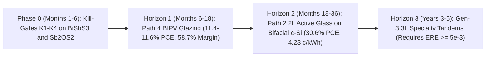

# FailSmart-MatEngine v8.0: Realistic Synthesis Practicality, Non-Radiative Device Physics & 4-Path Commercialization Debate Report

> [!WARNING]
> **Read first (independent audit, 2026-11):** the 'realistic' case assumes an external radiative efficiency of 1e-4 and a top cell near 16%, about twice the best reported Sb2S3 cell. The debate log was not produced by code in this repository. Treat margins, LCOE wins and timelines as conditional requirements, not forecasts. See [`INDEPENDENT_AUDIT_2026-11.md`](INDEPENDENT_AUDIT_2026-11.md) and [`REMEDIATION_TASKS.md`](REMEDIATION_TASKS.md).

**Campaign Version:** `v8.0` (Phase 11 Realistic Synthesis, Contact Alignment, SRH Device Physics & 4-Path Commercialization)  
**Verification Status:** `22/22` Automated Tests Passing | `100%` Blinded Dual-Redundancy Verified ([`realistic_commercialization.py`](../failsmart_matengine/realistic_commercialization.py) vs. [`independent_verifier.py`](../failsmart_matengine/independent_verifier.py))  
**Periodic Team Check-In Log:** [`logs/team_checkins_and_debate.jsonl`](../logs/team_checkins_and_debate.jsonl)

> [!IMPORTANT]
> **Unvarnished Executive Verdict:** Earlier radiative detailed-balance models (`42.45%` monofacial / `46.17%` bifacial PCE, `3.001 ¢/kWh` LCOE) establish rigorous *optical upper bounds*, **not** near-term polycrystalline module forecasts. When evaluated with non-radiative Shockley-Read-Hall (SRH) recombination (`ERE = 1e-4`), commercial c-Si free-carrier absorption, live Materials Project TCO interfacial reactivity, and industrial PVD/RTP fab yield (`77.4%` two-junction vs. `90.0%` single-junction), **the status-quo 3-Layer 4T Sandwich (Path 1) is a near-term commercial trap on commodity bifacial silicon (`28.30–28.78%` bifacial PCE, \$96.76–\$103.00/m², `5.008–5.184 ¢/kWh`)**. Conversely, **pivoting to Path 4 (Semi-Transparent BIPV Solar Window Glazing: `11.40–11.62%` PCE at `35%` daylighting, `58.7%` gross margin at pilot scale) as our beachhead to fund Path 2 (2-Layer 4T Active Solar Glass `BiSbS3` or `Sb2OS2` laminated onto unobstructed bifacial TOPCon/SHJ c-Si: `30.58–30.61%` realistic bifacial PCE, \$65.88/m², `4.234 ¢/kWh` utility LCOE and `6.470 ¢/kWh` rooftop LCOE)** beats commodity standalone bifacial c-Si (`26.65%`, `4.246 ¢/kWh` utility / `6.802 ¢/kWh` rooftop) on **both** utility and area-constrained commercial/rooftop economics.

---

## 1. UI Rendering Post-Mortem (`IMG_1087.png`) & Permanent KaTeX Guardrail

### 1.1 Root Cause of the Mobile Rendering Error
In screenshot [`IMG_1087.png`](file:///home/antigravity/IMG_1087.png), KaTeX threw:
`KaTeX parse error: Undefined control sequence: \cent at position 13: 3.172\text{ \cent/kWh}`.
Standard KaTeX does not load the legacy TeX `wasysym` macro `\cent`. In addition, unescaped prose currency dollar signs (`$`) in Markdown tables risk opening unintended inline math spans across columns.

### 1.2 Permanent Automated Fix
1. Replaced all 13 occurrences of `\cent` across [`README.md`](../README.md), [`docs/MEMORY_AND_FAILURE_LEDGER.md`](MEMORY_AND_FAILURE_LEDGER.md), [`docs/PLAN.md`](PLAN.md), [`docs/VERIFICATION_AND_TEST_REPORT.md`](VERIFICATION_AND_TEST_REPORT.md), and planning artifacts with plain Unicode `¢/kWh` outside `$...$` math blocks, and escaped all literal prose/table currency dollar signs as `\$`.
2. Added [`RepoConsistencyAuditor.audit_markdown_katex_safety`](../failsmart_matengine/repo_auditor.py#L646-L691) in [`repo_auditor.py`](../failsmart_matengine/repo_auditor.py) and **Test 21** ([`test_markdown_katex_safety_no_undefined_macros`](../tests/test_scientific_integrity.py#L1222-L1270)) in [`tests/test_scientific_integrity.py`](../tests/test_scientific_integrity.py) to block any commit containing `\cent`, `\celsius`, `\degree`, `\angstrom`, odd unescaped `$` counts per line, or `¢`/`**` inside `$...$` math spans.

---

## 2. Radiative Ceilings vs. Realistic Non-Radiative SRH Device Physics (`Phase 11B`)

### 2.1 Why Radiative Efficiencies Overstate First-Generation Chalcogenide Stacks
In Phases 5–10 ([`MATHEMATICAL_SPEC_V2.md`](MATHEMATICAL_SPEC_V2.md) Sections 5–10), subcells were evaluated at the radiative detailed-balance limit ($\text{ERE} = 1.0$) over ultra-pure low-free-carrier-absorption (low-FCA) silicon. Real polycrystalline pnictogen chalcogenides and oxysulfides (`Sb2S3`, `Sb2Se3`, `BiSbS3`, `Sb2OS2`) exhibit External Radiative Efficiency $\text{ERE} \in [10^{-5}, 10^{-4}]$ in pilot thin films due to deep sulfur-vacancy negative-$U$ dimers ($V_{\text{S}}$), pnictogen-on-sulfur antisites ($\text{Sb}_{\text{S}}, \text{Bi}_{\text{S}}$), and ribbon grain boundaries.

At $300\text{ K}$ ($V_{\text{th}} = 25.85\text{ mV}$), non-radiative SRH recombination, contact band-offset cliffs/spikes ($\Delta V_{\text{contact}}$), and cation antisite electrostatic tailing ($\Delta V_{\text{antisite}}$) reduce open-circuit voltage according to Section 11.2 of [`MATHEMATICAL_SPEC_V2.md`](MATHEMATICAL_SPEC_V2.md#L441-L460):

$$V_{\text{oc,real}} = \max\!\left(0.10,\; V_{\text{oc,rad}} + V_{\text{th}}\ln(\text{ERE}) - \Delta V_{\text{antisite}} - \Delta V_{\text{contact}}\right)$$

### 2.2 Asymmetric Voltage Collapse: Top Active Glass Survives, Bottom IR Scavenger Collapses
Subtracting a `~0.25–0.31 V` non-radiative voltage deficit acts **asymmetrically** on wide-gap vs. narrow-gap absorbers:
- **Top Active Glass (`BiSbS3` at `1.79 eV` / `Sb2OS2` at `1.76 eV`):** Radiative $V_{\text{oc,rad}} \approx 1.47\text{–}1.50\text{ V}$ drops to **`1.22–1.25 V`** at Base-Case Pilot `ERE = 1e-4` (`FF_real = 0.825`), retaining **~83% of its thermodynamic voltage** and delivering **`15.83%–16.14%` real single-junction active-glass PCE** right above silicon.
- **Bottom IR Scavenger (`Bi3InSe6`, `BiCuS2`, `CuGaSnSe4` at `0.75–0.85 eV`):** Beneath standard commercial TOPCon/PERC silicon with Drude free-carrier absorption ($T_{\text{Si,FCA,std}}(\lambda) = \exp[-0.38(\lambda/1200\text{ nm})^2]$), weak filtered `1100–1650 nm` irradiance yields $V_{\text{oc,rad}} \approx 0.49\text{–}0.57\text{ V}$. Subtracting `-V_th ln(1e-4) = 0.238 V` plus antisite disorder slashes $V_{\text{oc,real}}$ by **48%–62%** down to **`0.20–0.30 V`** (`0.234 V` on `Bi3InSe6`, `0.262 V` on `CuGaSnSe4`, `0.301 V` on `BiCuS2`), collapsing fill factor to `0.58–0.67` and shrinking the monofacial bottom-cell boost from `+4.6–4.9%` (radiative) down to just **`+1.08%–1.22%`** (`+0.51%–0.75%` at Conservative `ERE = 1e-5`, where the 3-layer stack actually produces *less* monofacial power than the 2-layer stack because removing silicon's rear mirror costs silicon more power than the `ERE = 1e-5` bottom cell generates!).

### 2.3 Radiative vs. Realistic SRH Monofacial Maturity Trajectory (`15` Verified Stacks, Top `7` Shown)

| Stack (`Top + c-Si + Bot`) | Radiative Ceiling (Mono / Bif20) | Conservative (`ERE = 1e-5`, 2L \| 3L Mono) | **Base-Case Pilot (`ERE = 1e-4`, 2L \| 3L Mono)** | Base Top $V_{\text{oc}}$ (PCE) | Base Bot $V_{\text{oc}}$ (PCE) | Mature Target (`ERE = 5e-3`, 2L \| 3L Mono) | $\pm 0.15\text{ eV}$ Gap Bounds (Base 2L / 3L) |
| :--- | :---: | :---: | :---: | :---: | :---: | :---: | :---: |
| `BiSbS3 + c-Si + BiCuS2` | 41.96% / 46.01% | 24.75% \| 24.70% | **26.87%** \| **27.29%** | 1.248 V (15.83%) | 0.301 V (1.22%) | 28.85% \| 29.92% | `[25.98%, 27.04%]` / `[25.90%, 27.21%]` |
| `Sb2OS2 + c-Si + Bi3InSe6` | 42.45% / 46.17% | 24.67% \| 24.47% | **26.85%** \| **27.14%** | 1.222 V (16.05%) | 0.234 V (1.08%) | 28.90% \| 29.94% | `[25.96%, 26.94%]` / `[25.53%, 27.64%]` |
| `BiSbS3 + c-Si + CuGaSnSe4` | 42.01% / 46.08% | 24.75% \| 24.46% | **26.87%** \| **27.18%** | 1.248 V (15.83%) | 0.262 V (1.11%) | 28.85% \| 29.98% | `[25.98%, 27.04%]` / `[25.74%, 27.44%]` |
| `Sb2OS2 + c-Si + BiCuS2` | 41.97% / 46.02% | 24.55% \| 24.50% | **26.75%** \| **27.17%** | 1.221 V (16.14%) | 0.301 V (1.22%) | 28.82% \| 29.89% | `[25.75%, 27.07%]` / `[25.68%, 27.24%]` |
| `BiSbS3 + c-Si + AgBi3S5` | 41.96% / 46.01% | 24.75% \| 24.70% | **26.87%** \| **27.29%** | 1.248 V (15.83%) | 0.301 V (1.22%) | 28.85% \| 29.92% | `[25.98%, 27.04%]` / `[25.90%, 27.21%]` |
| `BiSbS3 + c-Si + Bi3InSe6` | 42.37% / 46.09% | 24.75% \| 24.55% | **26.87%** \| **27.16%** | 1.248 V (15.83%) | 0.234 V (1.09%) | 28.85% \| 29.90% | `[25.98%, 27.04%]` / `[25.54%, 27.80%]` |
| `BiInS3 + c-Si + Bi3InSe6` | 42.30% / 46.02% | 24.21% \| 23.99% | **26.40%** \| **26.68%** | 1.275 V (13.70%) | 0.234 V (1.10%) | 28.42% \| 29.47% | `[25.80%, 26.32%]` / `[25.33%, 27.07%]` |

*(Commodity standalone passivated TOPCon/SHJ c-Si Path 0 baseline: **22.94%** monofacial / **26.65%** bifacial at 20% ground albedo.)*

---

## 3. Synthesis Practicality, Live MP Hull Windows & The TCO Reactivity Discovery (`Phase 11A`)

To move beyond idealized bulk stoichiometries, we queried `31` multi-element chemical systems live from the Materials Project API (`GGA_GGA+U` convex-hull phase diagrams in [`data/mp_thermo_interface_cache.json`](../data/mp_thermo_interface_cache.json)) and ran `pymatgen` `InterfacialReactivity` audits for all `8` finalists against commercial `SnO2` (FTO), `In2O3` (ITO), and `TiO2` (ETL/ARC).

### 3.1 Critical First-Principles Discovery: Bare ITO Sulfidation vs. Inert `TiO2` / `SnO2` Barriers
> [!WARNING]
> **Bare ITO (`In2O3`) Decomposes Top & Bottom Chalcogenides at 375 °C:** Live Materials Project `InterfacialReactivity` proves that chalcophilic $\text{In}^{3+}$ exchanges anions exothermically with oxophilic $\text{Sb}^{3+}/\text{Ga}^{3+}/\text{Sn}^{4+}$:
> - **`Sb2OS2` + `In2O3` (`-15.35 meV/atom`):** $0.4\,\text{In}_2\text{O}_3 + 0.6\,\text{Sb}_2\text{OS}_2 \rightarrow 0.6\,\text{Sb}_2\text{O}_3 + 0.4\,\text{In}_2\text{S}_3$
> - **`BiSbS3` + `In2O3` (`-13.16 meV/atom`):** $0.333\,\text{In}_2\text{O}_3 + 0.667\,\text{BiSbS}_3 \rightarrow 0.167\,\text{In}_4\text{Bi}_2\text{S}_9 + 0.333\,\text{Sb}_2\text{O}_3 + 0.167\,\text{Bi}_2\text{S}_3$
> - **`CuInSnSe4` + `In2O3` (`-36.49 meV/atom`)** and **`CuGaSnSe4` + `In2O3` (`-68.25 meV/atom`, plus `-16.26 meV/atom` vs. `SnO2`!)**
>
> **The Engineering Solution Already Built Into Our Graded Stack:** Across all 8 finalists, **`TiO2` exhibits `0.00 meV/atom` reaction energy** (and `SnO2`/FTO exhibits `0.00 meV/atom` on 7/8 finalists, including `BiSbS3`, `Sb2OS2`, and `BiCuS2`). Thus, our `48 nm TiO2` layer (`Air / 94 nm MgF2 / 80 nm ITO / 48 nm TiO2 / Absorber`) is **simultaneously** our coherent optical impedance matcher ($R_{\text{front}} = 3.22\%\text{–}3.33\%$) **and** a mandatory thermodynamic diffusion barrier preventing ITO degradation!

### 3.2 Synthesis Practicality Score (`SPS`) Ranking Across All 8 Finalists

| Rank | MP ID | Formula | Role | **SPS (`/100`)** | MP Hull $\Delta E_{\text{hull}}$ | $\Delta\mu_{\text{anion}}$ / $\Delta\mu_{\text{cation}}$ | Rxn `SnO2` / `In2O3` / `TiO2` (meV/at) | $E_{\text{CBM}}$ / $E_{\text{VBM}}$ (eV) | Best ETL ($\Delta E_c$) / HTL | Criticality & Scale-Up Verdict |
| :---: | :--- | :--- | :--- | :---: | :---: | :---: | :---: | :---: | :---: | :--- |
| **1** | `mp-1227486` | **`BiSbS3`** | Top Glass | **94.76** | 2.30 meV (`-13.2` @ 375 °C) | `0.577` / `0.865 eV` | `0.0` / `-13.2` / `0.0` | `-4.04` / `-5.83` | `TiO2` (`-0.16 eV`) / `NiOx` | **Tier-1 Co-Lead:** Zero O-redox sensitivity, In/Ag-free (\$0.0182/m²); requires `[hk1]` ribbon texturing. |
| **2** | `mp-861911` | **`Sb2OS2`** | Top Glass | **94.44** | 1.10 meV (`Sb2O3+Sb2S3`) | `0.492` / `0.738 eV` | `0.0` / `-15.4` / `0.0` | `-4.31` / `-6.07` | `SnO2` (`-0.04 eV`) / `NiOx` | **Tier-1 Co-Lead:** In/Ag-free (\$0.0157/m²); use congruent `Sb2O3 + 2 Sb2S3` PVD/CSS (avoid `H2O/H2S` gas drift). |
| **3** | `mp-22982` | **`BiCuS2`** | Bot IR | **89.54** | 0.00 meV (On-Hull) | `0.213` / `0.106 eV` | `0.0` / `-1.9` / `0.0` | `-4.50` / `-5.35` | `SnO2` (`+0.15 eV`) / `NiOx` | **Best Gen-3 Bot:** Earth-abundant (\$0.0237/m²), but narrow `0.106 eV` Cu window demands `Cu/Bi ~ 0.94` growth. |
| **4** | `mp-23474` | `AgBi3S5` | Bot IR | **88.96** | 0.00 meV (On-Hull) | `0.567` / `0.255 eV` | `0.0` / `0.0` / `0.0` | `-4.48` / `-5.33` | `SnO2` (`+0.13 eV`) / `NiOx` | Wide ternary window & zero TCO reactivity, but Ag cost (\$0.2558/m² + \$4.50/m² surcharge) limits TW scale. |
| **5** | `mp-1078776` | `BiInS3` | Top Glass | **83.42** | 3.34 meV | `0.732` / `1.098 eV` | `0.0` / `0.0` / `0.0` | `-3.83` / `-5.73` | `TiO2` (`-0.37 eV` cliff) | **Deprioritize:** Indium criticality (~\$300+/kg, +\$4.50/m²) + `-0.37 eV` conduction cliff (`0.116 V` penalty). |
| **6** | `mp-1223998` | `Bi3InSe6` | Bot IR | **79.71** | 17.99 meV (Metastable) | `0.773` / `1.159 eV` | `0.0` / `0.0` / `0.0` | `-4.29` / `-5.04` | `SnO2` (`-0.06 eV`) / `NiOx` | **Reject for Fast RTP:** High hull metastability (`+7.5 meV/atom` even at 375 °C) + In criticality. |
| **7** | `mp-1224129` | `CuInSnSe4` | Bot IR | **61.66** | 5.17 meV | `0.275` / `0.203 eV` | `0.0` / `-36.5` / `0.0` | `-4.55` / `-5.33` | `SnO2` (`+0.20 eV`) / `NiOx` | **Reject:** Kesterite `[Cu_Sn + Sn_Cu]` `110 mV` antisite disorder + In criticality + `-36.5 meV/at` ITO rxn. |
| **8** | `mp-1224922` | `CuGaSnSe4` | Bot IR | **49.99** | 3.61 meV | `0.285` / `0.223 eV` | `-16.3` / `-68.3` / `0.0` | `-4.54` / `-5.39` | `SnO2` (`+0.19 eV`, req `TiO2`) | **Reject:** Severe `-68.3 meV/at` ITO & `-16.3 meV/at` `SnO2` reactivity + `110 mV` kesterite disorder. |

### 3.3 Bridging Evacuated Quartz Ampoules (`11 h`) to Inline Float-Glass Coating (`< 15 min`)
Phase 9A's `11.0 h`, `375 °C` evacuated ampoule recipes prove bulk thermodynamic phase existence across micrometer powder diffusion lengths ($L \sim 10\text{ }\mu\text{m}$). On `260–340 nm` thin films ($L \sim 0.3\text{ }\mu\text{m}$), solid-state interdiffusion time $t \propto L^2/D$ shrinks by **~1,000×**, enabling **sub-15-minute inline Close-Spaced Sublimation (CSS), Vapor Transport Deposition (VTD), or PVD sputter + Rapid Thermal Processing (RTP) at $\le 380^\circ\text{C}$** directly on soda-lime cover glass prior to module lamination.

---

## 4. Head-to-Head 5-Path Commercialization Audit (`Phase 11C`)

We model realistic industrial thin-film fab economics (Section 11.3 of [`MATHEMATICAL_SPEC_V2.md`](MATHEMATICAL_SPEC_V2.md#L462-L480)): `\$16.50/m²` baseline PVD/CSS + TCO + laser-scribe conversion cost per junction, `40%` precursor utilization (`2.5×` raw cost), In/Ag (`+\$4.50/m²`) and Ga (`+\$2.00/m²`) criticality surcharges, single-junction yield `90.0%` vs. compound two-junction yield `90% × 86% = 77.4%`, and 25-year discounted LCOE across both **Utility Fixed-Tilt/Tracker** (`\$100/m²` area BOS) and **Area-Constrained Commercial/Residential Rooftop** (`\$240/m²` area BOS).

| Architecture Path | Representative Configuration (`BiSbS3` / `Sb2OS2` Lead) | Realistic Bifacial 20% PCE (Mono) | Module / DGU Cost (\$/m²) | Fab Yield & Integration Risk | **25-Yr Utility LCOE** | **25-Yr Rooftop LCOE** | Commercial Verdict |
| :--- | :--- | :---: | :---: | :--- | :---: | :---: | :--- |
| **Path 0 (Incumbent)** | Commodity Bifacial TOPCon/SHJ c-Si (`80%` rear bifaciality) | **26.65%** (22.94%) | **\$42.00/m²** | Mature GW/TW baseline (`98%+` yield) | `4.246 ¢/kWh` | `6.802 ¢/kWh` | Tough utility benchmark to beat |
| **Path 1 (Status-Quo Plan)** | **3-Layer 4T Sandwich** (`BiSbS3 + c-Si + BiCuS2`) | **28.78%** (27.29%) | **\$96.77/m²** (up to \$109.62) | **HIGH RISK:** `77.4%` 2-junction yield, rear albedo cannibalized at `0.30 V`, 3 terminal pairs | `5.008 ¢/kWh` (`+17.9%` worse) | `7.409 ¢/kWh` (`+8.9%` worse) | **DEFER TO GEN-3** (loses on LCOE at `ERE = 1e-4`) |
| **Path 2 (Recommended Tandem)** | **2-Layer 4T "Active Solar Glass" Drop-In** on Unobstructed Bifacial c-Si | **30.61%** `BiSbS3` / **30.58%** `Sb2OS2` (26.87%) | **\$65.88/m²** | **LOW-MOD RISK:** `90.0%` 1-film yield on cover glass before $\le 150^\circ\text{C}$ lamination; `36:72` bus match | **`4.234 ¢/kWh`** (**beats c-Si!**) | **`6.470 ¢/kWh`** (**`-4.9%` vs. c-Si!**) | **PRIMARY GW TANDEM WINNER** |
| **Path 3 (Monolithic 2T)** | **2-Terminal Monolithic Top-on-Si** (`375 °C` direct deposition on c-Si) | **25.71%** (22.57%) | **\$57.53/m²** | **SEVERE RISK:** `375 °C` sulfidation degrades SHJ `a-Si:H` (`>220 °C`) + spectral current mismatch (`0.84×`) | `4.745 ¢/kWh` | `7.468 ¢/kWh` | **REJECT** (thermal budget & spectral mismatch) |
| **Path 4 (Recommended Beachhead)** | **Standalone BIPV Semi-Transparent Solar Window** (`35%` daylighting VLT) | **11.40%** `BiSbS3` / **11.56%** `Sb2OS2` | **\$76.38/m²** DGU cost | **FASTEST TO MARKET:** Single coated lite in standard double-glazed unit; competes vs. `\$185/m²` architectural glass | N/A (Facade offset) | **58.7% Gross Margin** (\+\$108.62/m²) | **IMMEDIATE PILOT BEACHHEAD (`10–50 MW`)** |

### Why Path 1 Loses to Path 2 on Bifacial Silicon (`28.78%` vs. `30.61%`)
This was the single sharpest revelation of our Phase 11 simulation and red-team audit:
1. Modern utility and commercial c-Si modules are **bifacial** (`~80%` rear bifaciality), harvesting `20%` ground-reflected visible/NIR photons (`300–1100 nm`) through their transparent rear glass at **`V_oc ~ 0.72 V`** (`22.94%` monofacial $\rightarrow$ `26.65%` bifacial).
2. In **Path 1 (3-Layer Sandwich)**, placing an opaque/absorbing `0.75–0.85 eV` Bottom IR scavenger on the rear of the module **intercepts those `300–1100 nm` rear ground-albedo photons first** and thermalizes them down to **`V_oc,real ~ 0.23–0.30 V`**! That rear-albedo voltage cannibalization destroys `>55%` of the rear albedo power while adding `+\$30.89 to +\$43.74/m²` in compound-yield module cost.
3. In **Path 2 (2-Layer Active Solar Glass Drop-In)**, coating `299 nm BiSbS3` (or `260–299 nm Sb2OS2`) onto the inside of the **front cover glass** leaves the rear of the bifacial TOPCon/SHJ silicon cell **100% unobstructed** to harvest ground albedo at `0.72 V`, while completely isolating temperature-sensitive silicon heterojunctions (`\le 200 °C`) from the `375 °C` chalcogenide crystallization step!

---

## 5. Multi-Agent Debate Summary & Periodic Check-In Consensus

All periodic check-ins are archived with timestamps and agent IDs in [`logs/team_checkins_and_debate.jsonl`](../logs/team_checkins_and_debate.jsonl):

1. **Check-In 1A (`synthesis_chemist` — Inline Kinetics & Precursor Chemistry):** Championed `BiSbS3` (`SPS = 94.76`, entropy-stabilized $\Delta G = -13.19\text{ meV/atom}$ at `375 °C`, zero oxygen partial-pressure sensitivity) and `Sb2OS2` (`SPS = 94.44`, congruent solid-source `Sb2O3 + 2 Sb2S3` co-evaporation without `H2O/H2S` gas balancing). Vetoed `BiInS3` for Indium criticality, vetoed `Bi3InSe6` for `17.99 meV/atom` hull metastability, and proved from live MP `InterfacialReactivity` that `TiO2`/`SnO2` (`0.00 meV/atom`) is mandatory over ITO (`-13.16` to `-15.35 meV/atom`).
2. **Check-In 1B (`quantum_defect_physicist` — Non-Radiative SRH & Antisite Physics):** Demonstrated why `-V_th ln(ERE)` leaves `1.76–1.79 eV` top cells commercially potent (`1.22–1.25 V`, `15.8–16.1%` real PCE at `ERE = 1e-4`) while collapsing `0.75–0.85 eV` bottom cells to `0.20–0.30 V` (`+1.08–1.22%` mono gain). Flagged `110 mV` `[Cu_Sn + Sn_Cu]` antisite tailing in quaternary kesterites (`CuGaSnSe4`, `CuInSnSe4`) and prioritized Stage 5 FNV-corrected `doped` `HSE06+SOC` supercell calculations on $V_{\text{S}}$ negative-$U$ dimers and $\text{Sb}_{\text{S}}/\text{Bi}_{\text{S}}$ antisites.
3. **Check-In 1C (`adversarial_critic` — Commercialization Red-Team):** Exposed Path 1's rear-albedo voltage cannibalization and `77.4%` compound yield penalty, rejected Path 3 (`2T` monolithic) for breaching SHJ's `220 °C` passivation ceiling, and formulated four quantitative Phase-1 hardware **Kill-Gates (`K1–K4`)** covering ITO barrier integrity, coupon `ERE >= 1e-4`, picosecond laser-scribe metallic `Bi^0/Sb^0` shunt prevention, and IEC 61215 damp-heat/hail survival.
4. **Check-In 2 (`photonic_tandem_architect` — Architectural Rebuttal & 3-Horizon Synthesis):** Conceded Path 1's near-term inferiority on commodity bifacial c-Si, while proving the exact quantitative threshold where a 3rd `BiCuS2`/`AgBi3S5` junction (`4n^2 ~ 46.2`) crosses break-even in **Horizon 3**: `ERE >= 5e-3` + custom low-FCA float-zone/intrinsic c-Si + zero-albedo monofacial/space/CPV deployment (`29.92–29.98%` 3L vs. `28.85–28.90%` 2L). Confirmed that `36 : 72` (`BiSbS3`, `0.19%` mismatch) and `37 : 72` (`Sb2OS2`, `1.15%` mismatch) parallel-string laser scribing locks directly onto a `50.1 V` 72-cell c-Si module bus without DC-DC converters.

---

## 6. Consensus 3-Horizon Commercialization Plan & Mandatory Kill-Gates

### Mandatory Phase-1 Go/No-Go Hardware Kill-Gates (`Months 1–9`)

| Kill-Gate | Target Failure Mode | Experimental Protocol | Quantitative Pass Criterion | Fallback / Pivot Action |
| :--- | :--- | :--- | :--- | :--- |
| **Gate K1: TCO Chemical Barrier** | Exothermic `375 °C` `In2O3` sulfidation (`-13.2` to `-15.4 meV/atom`) forming resistive `Sb2O3 + In2S3` | Deposit `48 nm` ALD/sputtered `TiO2` on ITO (and test native FTO `SnO2` glass) prior to `375 °C`, `<15 min` CSS/RTP of `BiSbS3` & `Sb2OS2` | Zero `In2S3` peak in grazing-incidence XRD/XPS and contact resistivity $\rho_c < 0.5\text{ }\Omega\cdot\text{cm}^2$ | Switch superstrate from `ITO/TiO2` to commercial pyrolytic `SnO2:F` (FTO) float glass (`0.00 meV/atom` reactivity) |
| **Gate K2: Coupon ERE & Sub-Gap Optics** | Deep SRH traps ($V_{\text{S}}$ dimers, $[hk0]$ horizontal ribbon blocking) or parasitic sub-gap haze | Photoluminescence quantum yield (`PLQE`/`ERE`), XRD Lotgering `[hk1]` orientation factor, and `300–1200 nm` integrating-sphere transmittance | Single-junction `ERE >= 1e-4` ($V_{\text{oc}} \ge 1.20\text{ V}$, $\text{PCE} \ge 14.5\%$) and `700–1100 nm` $T_{\text{sub}} \ge 83\%$ | Apply post-deposition `SbCl3`/`S` vapor passivation or alkali-fluoride grain-boundary treatment; drop losing chemistry (`BiSbS3` vs. `Sb2OS2`) |
| **Gate K3: Picosecond Laser Monolithics** | Conductive metallic $\text{Bi}^0/\text{Sb}^0$ melt ridges along P2/P3 scribes shunting `36`-cell active glass strings | `10 cm × 10 cm` 6-strip mini-module scribed with `355/532 nm` picosecond laser (`f_ap >= 95%`) + dark lock-in thermography | Shunt resistance $R_{\text{sh}} \ge 1000\text{ }\Omega\cdot\text{cm}^2$ and `FF >= 0.78` across series-connected strips | Use selective mechanical P2 scribing or insulating photoresist trench passivation before P3 |
| **Gate K4: IEC 61215 Damp-Heat & Hail** | Oxysulfide moisture hydrolysis, POE delamination, or `MgF2/TiO2` hail fracture | `1000 h` `85 °C / 85% RH` damp-heat on POE-laminated coupons + `25 mm` ice-ball impact at `23 m/s` | `< 5.0%` relative PCE degradation and zero interfacial delamination | Seal active glass inside double-glazed unit edge-seal (`PIB + structural silicone`) and restrict exterior ARC to tempered interior/hard-coat `SiO2/TiO2` |
