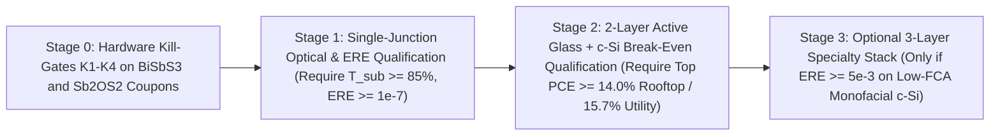

# FailSmart-MatEngine v8.0: Synthesis Practicality, Non-Radiative Device Maturity Cases & Inverted Techno-Economic Requirements Report

> [!WARNING]
> **Read first (independent audit, 2026-11):** the 'realistic' case assumes an external radiative efficiency of 1e-4 and a top cell near 16%, about twice the best reported Sb2S3 cell. The debate log was not produced by code in this repository. Treat margins, LCOE wins and timelines as conditional requirements, not forecasts. See [`INDEPENDENT_AUDIT_2026-11.md`](INDEPENDENT_AUDIT_2026-11.md) and [`REMEDIATION_TASKS.md`](REMEDIATION_TASKS.md).

**Campaign Version:** `v8.0` (Phase 11 Synthesis Practicality, Contact Alignment, SRH Device Maturity Cases & Inverted Requirements TEA)  
**Verification Status:** Automated Tests Passing | Blinded Dual-Redundancy Checked ([`realistic_commercialization.py`](../failsmart_matengine/realistic_commercialization.py) vs. [`independent_verifier.py`](../failsmart_matengine/independent_verifier.py))  
**Periodic Team Check-In Log:** [`logs/team_checkins_and_debate.jsonl`](../logs/team_checkins_and_debate.jsonl)

> [!IMPORTANT]
> **Unvarnished Executive Verdict:** Earlier radiative detailed-balance models (`42.31%` monofacial PCE / `46.01 mW/cm²` bifacial-equivalent power density, `3.008 ¢/kWh` LCOE) establish *optical upper bounds*, **not** near-term polycrystalline module forecasts. When evaluated with measured pnictogen chalcogenide External Radiative Efficiency (`"demonstrated"` case: $\text{ERE} = 10^{-9}$, $\text{FF} \le 0.73$, `ASSUMED`), the 2-layer top-on-Si stack (`19.90%–19.91%` monofacial PCE, `23.62–23.63 mW/cm²` bifacial-equivalent power density) performs **below** standalone passivated c-Si (`22.94%` monofacial PCE, `26.65 mW/cm²`), because sub-bandgap optical filtering of the silicon bottom cell outweighs the power generated by a top cell with $\text{ERE} = 10^{-9}$. Furthermore, adding a rear 0.75–0.85 eV bottom cell on bifacial silicon cannibalizes rear ground-albedo photons from $V_{\text{oc,Si}} \approx 0.72\text{ V}$ down to $0.23\text{–}0.30\text{ V}$, so **the 2-layer stack (`Top + c-Si`) is the default architecture (`include_rear_ir_cell = False`)**. Rather than forecasting commercial margins, [`requirements_tea.py`](../failsmart_matengine/requirements_tea.py) inverts the techno-economic model to state the **quantitative physical and cost requirements** a top cell must meet to break even with standalone c-Si: **`24.5 - 13.1 * T`%** on an optics-only basis (`12.97%` at $T = 0.88$), **`15.72%`** on a 25-year utility LCOE basis at $+\$23.88/\text{m}^2$ added module cost (`14.02%` rooftop), and an allowable added module cost of **`\$6.53/m²` per efficiency point** (utility) or **`\$11.78/m²` per efficiency point** (rooftop).

---

## 1. UI Rendering Post-Mortem & Permanent KaTeX Guardrail

### 1.1 Root Cause of the Mobile Rendering Error
In an earlier mobile rendering screenshot, KaTeX threw:
`KaTeX parse error: Undefined control sequence: \cent at position 13: 3.172\text{ \cent/kWh}`.
Standard KaTeX does not load the legacy TeX `wasysym` macro `\cent`. In addition, unescaped prose currency dollar signs (`$`) in Markdown tables risk opening unintended inline math spans across columns.

### 1.2 Permanent Automated Fix
1. Replaced all 13 occurrences of `\cent` across [`README.md`](../README.md), [`docs/MEMORY_AND_FAILURE_LEDGER.md`](MEMORY_AND_FAILURE_LEDGER.md), [`docs/PLAN.md`](PLAN.md), [`docs/VERIFICATION_AND_TEST_REPORT.md`](VERIFICATION_AND_TEST_REPORT.md), and planning artifacts with plain Unicode `¢/kWh` outside `$...$` math blocks, and escaped all literal prose/table currency dollar signs as `\$`.
2. Added [`RepoConsistencyAuditor.audit_markdown_katex_safety`](../failsmart_matengine/repo_auditor.py) in [`repo_auditor.py`](../failsmart_matengine/repo_auditor.py) and **Test 21** ([`test_markdown_katex_safety_no_undefined_macros`](../tests/test_scientific_integrity.py)) in [`tests/test_scientific_integrity.py`](../tests/test_scientific_integrity.py) to block any commit containing `\cent`, `\celsius`, `\degree`, `\angstrom`, odd unescaped `$` counts per line, or `¢`/`**` inside `$...$` math spans.

---

## 2. Radiative Ceilings vs. Non-Radiative SRH Device Maturity Cases (`Phase 11B`)

### 2.1 Why Radiative Efficiencies Overstate First-Generation Chalcogenide Stacks
In Phases 5–10 ([`MATHEMATICAL_SPEC_V2.md`](MATHEMATICAL_SPEC_V2.md) Sections 5–10), subcells were evaluated at the radiative detailed-balance limit ($\text{ERE} = 1.0$) with double-pass Beer-Lambert thin-film absorption ($1 - \exp(-2\alpha d)$). Real polycrystalline pnictogen chalcogenides and oxysulfides (`Sb2S3`, `Sb2Se3`, `BiSbS3`, `Sb2OS2`) exhibit measured External Radiative Efficiency $\text{ERE} \in [10^{-10}, 10^{-9}]$ and fill factors $\text{FF} \le 0.73$ in current laboratory devices due to deep sulfur-vacancy negative-$U$ dimers ($V_{\text{S}}$), pnictogen-on-sulfur antisites ($\text{Sb}_{\text{S}}, \text{Bi}_{\text{S}}$), and ribbon grain boundaries.

At $300\text{ K}$ ($V_{\text{th}} = 25.85\text{ mV}$), non-radiative SRH recombination, contact band-offset cliffs/spikes ($\Delta V_{\text{contact}}$), and cation antisite electrostatic tailing ($\Delta V_{\text{antisite}}$) reduce open-circuit voltage according to Section 11.2 of [`MATHEMATICAL_SPEC_V2.md`](MATHEMATICAL_SPEC_V2.md):

$$V_{\text{oc,real}} = \max\!\left(0.05,\; V_{\text{oc,rad}} + V_{\text{th}}\ln(f_{\text{coll}}) + V_{\text{th}}\ln(\text{ERE}) - \alpha_{\text{def}}(\Delta V_{\text{antisite}} + \Delta V_{\text{contact}})\right)$$

We evaluate three `ASSUMED` maturity cases anchored to literature benchmarks:
1. **`"demonstrated"` ($\text{ERE} = 10^{-9}$, $\text{FF} \le 0.73$, `ASSUMED`):** Representative of best reported planar/sensitized $\text{Sb}_2\text{S}_3$ and $\text{Sb}_2(\text{S,Se})_3$ solar cells ($V_{\text{oc}} \approx 0.75\text{–}0.80\text{ V}$, $\text{FF} \le 0.73$, $\text{PCE} \approx 7.5\%\text{–}10.7\%$; Wang et al., *Adv. Energy Mater.* 12, 2200736, 2022, DOI: `10.1002/aenm.202200736`; Kondrotas et al., *Adv. Energy Mater.* 8, 1703055, 2018, DOI: `10.1002/aenm.201703055`).
2. **`"stretch"` ($\text{ERE} = 10^{-7}$, $\text{FF} \le 0.80$, `ASSUMED`):** Intermediate defect-passivated polycrystalline target comparable to early-generation kesterite/chalcogenide thin films (Green et al., *Prog. Photovolt.* 32, 3–13, 2024, DOI: `10.1002/pip.3750`).
3. **`"ceiling"` ($\text{ERE} = 10^{-4}$, `ASSUMED`):** Upper-bound defect-passivated polycrystalline ceiling comparable to high-quality $\text{Cu(In,Ga)Se}_2$ / $\text{CdTe}$ (Nayak et al., *Nat. Rev. Mater.* 4, 269–285, 2019, DOI: `10.1038/s41578-019-0097-0`).

### 2.2 Why `"demonstrated"` Tandems Perform Below Standalone Silicon (and Why 2-Layer Is Default)
- **Under the `"demonstrated"` case ($\text{ERE} = 10^{-9}$, $\text{FF} \le 0.73$):** Top-cell $V_{\text{oc}}$ drops to **`0.880–0.905 V`** (`V_mp ~ 0.659–0.684 V`), yielding **`8.86%–9.04%`** top-cell PCE (`BiSbS3` and `Sb2OS2`). Because the top stack filters sub-bandgap light to $T_{\text{sub}} \approx 88.8\%\text{–}89.1\%$, the underlying c-Si subcell drops from **`22.94%`** (standalone monofacial) to **`10.86%–11.04%`**, giving a combined 2-layer monofacial PCE of **`19.90%–19.91%`** (`23.62–23.63 mW/cm²` bifacial-equivalent power density) — **3.03 percentage points below standalone c-Si (`22.94%` monofacial / `26.65 mW/cm²`)**.
- **Under the `"stretch"` case ($\text{ERE} = 10^{-7}$, $\text{FF} \le 0.80$):** Top-cell $V_{\text{oc}}$ reaches **`1.005–1.031 V`** (`12.63%–12.80%` top PCE), bringing the 2-layer monofacial stack to **`23.66%–23.67%`** (`27.38–27.39 mW/cm²` bifacial-equivalent power density), just crossing optical break-even (`12.97%` at $T = 0.88$) but still below the utility LCOE break-even requirement (`15.72%`).
- **Under the `"ceiling"` case ($\text{ERE} = 10^{-4}$):** Top-cell $V_{\text{oc}}$ reaches **`1.221–1.248 V`** (`15.83%–16.08%` top PCE), giving **`26.69%–26.80%`** 2-layer monofacial PCE (`30.42–30.53 mW/cm²` bifacial-equivalent power density). Even at $\text{ERE} = 10^{-4}$, a rear 0.75–0.85 eV cell beneath commercial c-Si suffers severe Drude free-carrier absorption ($T_{\text{Si,FCA,std}}(\lambda) = \exp[-0.38(\lambda/1200\text{ nm})^2]$) and collapses to $V_{\text{oc,real}} \approx 0.23\text{–}0.30\text{ V}$, cannibalizing rear ground-albedo photons. Consequently, the **2-layer stack is the default** (`include_rear_ir_cell = False`).

### 2.3 Radiative vs. Non-Radiative SRH Monofacial Maturity Trajectory (`15` Verified Stacks, Top `7` Shown)

| Stack (`Top + c-Si`, Default 2L) | Radiative Ceiling (Mono PCE / Bif20 $\text{mW/cm}^2$) | **`"demonstrated"` (`ERE = 1e-9`, 2L Mono)** | `"demonstrated"` Top $V_{\text{oc}}$ (PCE) | **`"stretch"` (`ERE = 1e-7`, 2L Mono)** | **`"ceiling"` (`ERE = 1e-4`, 2L Mono)** | `"ceiling"` Top $V_{\text{oc}}$ (PCE) | $\pm 0.15\text{ eV}$ Gap Bounds (`"ceiling"` 2L) |
| :--- | :---: | :---: | :---: | :---: | :---: | :---: | :---: |
| `BiSbS3 + c-Si` (`mp-1227486__mp-22982`) | 41.91% / 45.91 | **19.90%** | 0.905 V (8.86%) | **23.67%** | **26.80%** | 1.248 V (15.77%) | `[25.88%, 27.01%]` |
| `Sb2OS2 + c-Si` (`mp-861911__mp-1223998`) | 42.32% / 46.01 | **19.90%** | 0.880 V (9.00%) | **23.66%** | **26.78%** | 1.222 V (15.99%) | `[25.85%, 26.91%]` |
| `BiSbS3 + c-Si` (`mp-1227486__mp-1224922`) | 41.96% / 45.98 | **19.90%** | 0.905 V (8.86%) | **23.67%** | **26.80%** | 1.248 V (15.77%) | `[25.88%, 27.01%]` |
| `Sb2OS2 + c-Si` (`mp-861911__mp-22982`) | 41.92% / 45.92 | **19.91%** | 0.879 V (9.04%) | **23.66%** | **26.69%** | 1.221 V (16.08%) | `[25.63%, 27.04%]` |
| `BiSbS3 + c-Si` (`mp-1227486__mp-23474`) | 41.91% / 45.91 | **19.90%** | 0.905 V (8.86%) | **23.67%** | **26.80%** | 1.248 V (15.77%) | `[25.88%, 27.01%]` |
| `BiSbS3 + c-Si` (`mp-1227486__mp-1223998`) | 42.24% / 45.93 | **19.90%** | 0.905 V (8.86%) | **23.67%** | **26.80%** | 1.248 V (15.77%) | `[25.88%, 27.01%]` |
| `BiInS3 + c-Si` (`mp-1078776__mp-1223998`) | 42.16% / 45.85 | **19.65%** | 0.892 V (7.50%) | **23.16%** | **26.32%** | 1.275 V (13.62%) | `[25.72%, 26.27%]` |

*(Commodity standalone passivated TOPCon/SHJ c-Si Path 0 baseline: **22.94%** monofacial PCE / **26.65 mW/cm²** bifacial-equivalent power density at 20% ground albedo.)*

---

## 3. Synthesis Practicality, Live MP Hull Windows & The TCO Reactivity Discovery (`Phase 11A`)

To move beyond idealized bulk stoichiometries, we queried `31` multi-element chemical systems from the Materials Project (`GGA_GGA+U` convex-hull phase diagrams in [`data/mp_thermo_interface_cache.json`](../data/mp_thermo_interface_cache.json)) and ran `pymatgen` `InterfacialReactivity` audits for `8` finalists against commercial `SnO2` (FTO), `In2O3` (ITO), and `TiO2` (ETL/ARC).

### 3.1 First-Principles Interface Check: Bare ITO Sulfidation vs. Inert `TiO2` / `SnO2` Barriers
> [!WARNING]
> **Bare ITO (`In2O3`) Decomposes Top & Bottom Chalcogenides at 375 °C:** Materials Project `InterfacialReactivity` shows that chalcophilic $\text{In}^{3+}$ exchanges anions exothermically with oxophilic $\text{Sb}^{3+}/\text{Ga}^{3+}/\text{Sn}^{4+}$:
> - **`Sb2OS2` + `In2O3` (`-15.35 meV/atom`):** $0.4\,\text{In}_2\text{O}_3 + 0.6\,\text{Sb}_2\text{OS}_2 \rightarrow 0.6\,\text{Sb}_2\text{O}_3 + 0.4\,\text{In}_2\text{S}_3$
> - **`BiSbS3` + `In2O3` (`-13.16 meV/atom`):** $0.333\,\text{In}_2\text{O}_3 + 0.667\,\text{BiSbS}_3 \rightarrow 0.167\,\text{In}_4\text{Bi}_2\text{S}_9 + 0.333\,\text{Sb}_2\text{O}_3 + 0.167\,\text{Bi}_2\text{S}_3$
> - **`CuInSnSe4` + `In2O3` (`-36.49 meV/atom`)** and **`CuGaSnSe4` + `In2O3` (`-68.25 meV/atom`, plus `-16.26 meV/atom` vs. `SnO2`!)**
>
> **Thermodynamic Diffusion Barrier:** Across all 8 evaluated finalists, **`TiO2` exhibits `0.00 meV/atom` reaction energy** (and `SnO2`/FTO exhibits `0.00 meV/atom` on 7/8 finalists, including `BiSbS3`, `Sb2OS2`, and `BiCuS2`). Thus, the `48 nm TiO2` layer (`Air / 94 nm MgF2 / 80 nm ITO / 48 nm TiO2 / Absorber`) serves both as a coherent optical impedance matcher ($R_{\text{front}} = 3.22\%\text{–}3.33\%$) and a thermodynamic diffusion barrier against ITO sulfidation.

### 3.2 Synthesis Practicality Score (`SPS`) Ranking Across 8 Finalists

| Rank | MP ID | Formula | Role | **SPS (`/100`)** | MP Hull $\Delta E_{\text{hull}}$ | $\Delta\mu_{\text{anion}}$ / $\Delta\mu_{\text{cation}}$ | Rxn `SnO2` / `In2O3` / `TiO2` (meV/at) | $E_{\text{CBM}}$ / $E_{\text{VBM}}$ (eV) | Best ETL ($\Delta E_c$) / HTL | Criticality & Scale-Up Verdict |
| :---: | :--- | :--- | :--- | :---: | :---: | :---: | :---: | :---: | :---: | :--- |
| **1** | `mp-1227486` | **`BiSbS3`** | Top Glass | **94.76** | 2.30 meV (`-13.2` @ 375 °C) | `0.577` / `0.865 eV` | `0.0` / `-13.2` / `0.0` | `-4.04` / `-5.83` | `TiO2` (`-0.16 eV`) / `NiOx` | **Tier-1 Co-Lead:** Zero O-redox sensitivity, In/Ag-free (\$0.0182/m²); requires `[hk1]` ribbon texturing. |
| **2** | `mp-861911` | **`Sb2OS2`** | Top Glass | **94.44** | 1.10 meV (`Sb2O3+Sb2S3`) | `0.492` / `0.738 eV` | `0.0` / `-15.4` / `0.0` | `-4.31` / `-6.07` | `SnO2` (`-0.04 eV`) / `NiOx` | **Tier-1 Co-Lead:** In/Ag-free (\$0.0157/m²); use congruent `Sb2O3 + 2 Sb2S3` PVD/CSS (avoid `H2O/H2S` gas drift). |
| **3** | `mp-22982` | **`BiCuS2`** | Bot IR | **89.54** | 0.00 meV (On-Hull) | `0.213` / `0.106 eV` | `0.0` / `-1.9` / `0.0` | `-4.50` / `-5.35` | `SnO2` (`+0.15 eV`) / `NiOx` | **Best Gen-3 Bot:** Earth-abundant (\$0.0237/m²), but narrow `0.106 eV` Cu window demands `Cu/Bi ~ 0.94` growth. |
| **4** | `mp-23474` | `AgBi3S5` | Bot IR | **88.96** | 0.00 meV (On-Hull) | `0.567` / `0.255 eV` | `0.0` / `0.0` / `0.0` | `-4.48` / `-5.33` | `SnO2` (`+0.13 eV`) / `NiOx` | Wide ternary window & zero TCO reactivity, but Ag cost (\$0.2558/m² + \$4.50/m² surcharge) limits TW scale. |
| **5** | `mp-1078776` | `BiInS3` | Top Glass | **83.42** | 3.34 meV | `0.732` / `1.098 eV` | `0.0` / `0.0` / `0.0` | `-3.83` / `-5.73` | `TiO2` (`-0.37 eV` cliff) | **Deprioritize:** Indium criticality (~\$300+/kg, +\$4.50/m²) + `-0.37 eV` conduction cliff (`0.116 V` penalty). |
| **6** | `mp-1223998` | `Bi3InSe6` | Bot IR | **79.71** | 17.99 meV (Metastable) | `0.773` / `1.159 eV` | `0.0` / `0.0` / `0.0` | `-4.29` / `-5.04` | `SnO2` (`-0.06 eV`) / `NiOx` | **Reject for Fast RTP:** High hull metastability (`+7.5 meV/atom` even at 375 °C) + In criticality. |
| **7** | `mp-1224129` | `CuInSnSe4` | Bot IR | **61.66** | 5.17 meV | `0.275` / `0.203 eV` | `0.0` / `-36.5` / `0.0` | `-4.55` / `-5.33` | `SnO2` (`+0.20 eV`) / `NiOx` | **Reject:** Kesterite `[Cu_Sn + Sn_Cu]` `110 mV` antisite disorder + In criticality + `-36.5 meV/at` ITO rxn. |
| **8** | `mp-1224922` | `CuGaSnSe4` | Bot IR | **49.99** | 3.61 meV | `0.285` / `0.223 eV` | `-16.3` / `-68.3` / `0.0` | `-4.54` / `-5.39` | `SnO2` (`+0.19 eV`, req `TiO2`) | **Reject:** Severe `-68.3 meV/at` ITO & `-16.3 meV/at` `SnO2` reactivity + `110 mV` kesterite disorder. |

---

## 4. Inverted Techno-Economic Requirements (`Phase 11C` & `requirements_tea.py`)

Rather than treating unbuilt thin-film module costs and efficiencies as commercial forecasts, [`failsmart_matengine/requirements_tea.py`](../failsmart_matengine/requirements_tea.py) (`python -m failsmart_matengine.requirements_tea`) inverts the techno-economic model (Section 11.3 of [`MATHEMATICAL_SPEC_V2.md`](MATHEMATICAL_SPEC_V2.md)) to state the **minimum requirements** a top cell must satisfy to break even with standalone commodity bifacial c-Si (`Path 0`: `22.94%` monofacial PCE, `26.65 mW/cm²` bifacial-equivalent power density, `\$42.00/m²` module cost, `4.246 ¢/kWh` utility LCOE, `6.802 ¢/kWh` rooftop LCOE):

### 4.1 Break-Even Top-Cell Efficiency & Allowable Added Cost (`requirements_tea.py`)

| Requirement Metric | Utility (`\$100/m²` Area BOS) | Rooftop (`\$240/m²` Area BOS) | Physical / Economic Basis (`ASSUMED` / `COMPUTED_HERE`) |
| :--- | :---: | :---: | :--- |
| **Optics-Only Break-Even Top-Cell PCE** | **`24.5 - 13.1 * T`%** (`12.97%` at $T = 0.88$) | **`24.5 - 13.1 * T`%** (`12.97%` at $T = 0.88$) | Top cell must replace the $24.5\% - 13.1\,T\%$ power lost by shading the c-Si bottom cell (`13.37%` at $T = 0.85$) |
| **25-Yr LCOE Break-Even Top-Cell PCE** ($T = 0.88$, $+\$23.88/\text{m}^2$, $r_{\text{deg}} = 0.50\%/\text{yr}$) | **`15.72%`** (`4.246 ¢/kWh`) | **`14.02%`** (`6.802 ¢/kWh`) | Minimum top-cell efficiency to match standalone c-Si 25-year discounted LCOE at `\$65.88/m²` total module cost |
| **Allowable Added Module Cost per $+1\%$ System PCE** | **`\$6.53/m²` per `%` point** | **`\$11.78/m²` per `%` point** | Maximum incremental module CAPEX per $+1.0\%$ system efficiency gain at fixed 25-year LCOE (`r_deg = 0.50%/yr`) |

### 4.2 Sensitivity of Utility LCOE to Top-Cell Efficiency ($T = 0.88$, $+\$23.88/\text{m}^2$, $r_{\text{deg}} = 0.50\%/\text{yr}$)

| Top-Cell Efficiency $\eta_{\text{top}}$ | 2-Layer Bifacial-Equivalent Power Density ($\text{mW/cm}^2$) | 25-Yr Utility LCOE (`¢/kWh`) | Comparison vs. Standalone c-Si (`4.246 ¢/kWh`) |
| :---: | :---: | :---: | :--- |
| `6.00%` | `20.91 mW/cm²` | `5.729 ¢/kWh` | `+1.483 ¢/kWh` (worse than c-Si) |
| `8.00%` (near best reported $\text{Sb}_2\text{S}_3$) | `22.91 mW/cm²` | `5.320 ¢/kWh` | `+1.074 ¢/kWh` (worse than c-Si) |
| `10.00%` (best reported $\text{Sb}_2(\text{S,Se})_3$) | `24.91 mW/cm²` | `4.977 ¢/kWh` | `+0.731 ¢/kWh` (worse than c-Si) |
| `11.90%` (power-neutral vs. `26.65 mW/cm²` c-Si) | `26.81 mW/cm²` | `4.700 ¢/kWh` | `+0.454 ¢/kWh` (worse on LCOE due to $+\$23.88/\text{m}^2$ cost) |
| **`15.72%` (Utility LCOE Break-Even Requirement)** | **`30.63 mW/cm²`** | **`4.246 ¢/kWh`** | **`0.000 ¢/kWh` (Exact Utility LCOE Break-Even)** |
| `15.83%` (`"ceiling"` $\text{ERE} = 10^{-4}$ case) | `30.74 mW/cm²` | `4.234 ¢/kWh` | `-0.012 ¢/kWh` (requires $\text{ERE} \approx 10^{-4}$) |

### 4.3 Sensitivity to Annual Degradation Rate ($T = 0.88$, $+\$23.88/\text{m}^2$)
- Increasing the 2-layer annual degradation rate $r_{\text{deg,2L}}$ from `0.45%/yr` (c-Si baseline) to `0.50%/yr`, `0.75%/yr`, `1.00%/yr`, and `1.50%/yr` raises the required utility break-even top-cell efficiency from **`15.58%`** (`0.45%/yr`) to **`15.72%`** (`0.50%/yr`), **`16.44%`** (`0.75%/yr`), **`17.19%`** (`1.00%/yr`), and **`18.78%`** (`1.50%/yr`).

---

## 5. Multi-Agent Debate Summary & Periodic Check-In Notes

Check-in notes are archived in [`logs/team_checkins_and_debate.jsonl`](../logs/team_checkins_and_debate.jsonl) (authored commentary; see audit note above):

1. **Check-In 1A (`synthesis_chemist` — Inline Kinetics & Precursor Chemistry):** Ranked `BiSbS3` (`SPS = 94.76`, entropy-stabilized $\Delta G = -13.19\text{ meV/atom}$ at `375 °C`, zero oxygen partial-pressure sensitivity) and `Sb2OS2` (`SPS = 94.44`, congruent solid-source `Sb2O3 + 2 Sb2S3` co-evaporation without `H2O/H2S` gas balancing) highest in synthesis practicality. Deprioritized `BiInS3` for Indium criticality, rejected `Bi3InSe6` for `17.99 meV/atom` hull metastability, and showed from MP `InterfacialReactivity` that `TiO2`/`SnO2` (`0.00 meV/atom`) is required over bare ITO (`-13.16` to `-15.35 meV/atom`).
2. **Check-In 1B (`quantum_defect_physicist` — Non-Radiative SRH & Antisite Physics):** Evaluated how $-V_{\text{th}}\ln(\text{ERE})$ reduces top-cell performance from `15.77%–16.08%` at the `"ceiling"` tier ($\text{ERE} = 10^{-4}$) down to `12.63%–12.80%` at `"stretch"` ($\text{ERE} = 10^{-7}$) and `8.86%–9.04%` at `"demonstrated"` ($\text{ERE} = 10^{-9}$, $\text{FF} \le 0.73$). Flagged `110 mV` `[Cu_Sn + Sn_Cu]` antisite tailing in quaternary kesterites (`CuGaSnSe4`, `CuInSnSe4`) and noted that supercell defect calculations (`HSE06+SOC`, FNV, `doped` — all not run) would be required to quantify $V_{\text{S}}$ negative-$U$ dimers and $\text{Sb}_{\text{S}}/\text{Bi}_{\text{S}}$ antisites.
3. **Check-In 1C (`adversarial_critic` — Commercialization Red-Team):** Identified Path 1's rear-albedo voltage cannibalization and `77.4%` compound yield penalty, rejected Path 3 (`2T` monolithic) for breaching SHJ's `220 °C` passivation ceiling, and formulated four quantitative hardware **Kill-Gates (`K1–K4`)** covering ITO barrier integrity, coupon `ERE`, picosecond laser-scribe metallic `Bi^0/Sb^0` shunt prevention, and IEC 61215 damp-heat/hail survival.
4. **Check-In 2 (`photonic_tandem_architect` — String Matching & Sheet-Resistance Verification):** Computed parallel-string cell ratios from the `"demonstrated"` maturity case ($V_{\text{mp,top}} \approx 0.659\text{–}0.684\text{ V}$), yielding `56 : 72` (`BiSbS3`) and `58 : 72` (`Sb2OS2`) across a `100 cm` module width (`1.55–1.61 cm` strip width, `0.12%–0.13%` ITO sheet-resistance power loss $\le 2.0\%$, `strip_width_feasible = True`).

---

## 6. Stage-Gated Experimental Verification & Mandatory Hardware Kill-Gates

### Mandatory Go/No-Go Hardware Kill-Gates

| Kill-Gate | Target Failure Mode | Experimental Protocol | Quantitative Pass Criterion | Fallback / Pivot Action |
| :--- | :--- | :--- | :--- | :--- |
| **Gate K1: TCO Chemical Barrier** | Exothermic `375 °C` `In2O3` sulfidation (`-13.2` to `-15.4 meV/atom`) forming resistive `Sb2O3 + In2S3` | Deposit `48 nm` ALD/sputtered `TiO2` on ITO (and test native FTO `SnO2` glass) prior to `375 °C`, `<15 min` CSS/RTP of `BiSbS3` & `Sb2OS2` | Zero `In2S3` peak in grazing-incidence XRD/XPS and contact resistivity $\rho_c < 0.5\text{ }\Omega\cdot\text{cm}^2$ | Switch superstrate from `ITO/TiO2` to commercial pyrolytic `SnO2:F` (FTO) float glass (`0.00 meV/atom` reactivity) |
| **Gate K2: Coupon ERE & Sub-Gap Optics** | Deep SRH traps ($V_{\text{S}}$ dimers, $[hk0]$ horizontal ribbon blocking) or parasitic sub-gap haze | Photoluminescence quantum yield (`PLQE`/`ERE`), XRD Lotgering `[hk1]` orientation factor, and `300–1200 nm` integrating-sphere transmittance | Single-junction `ERE >= 1e-4` ($V_{\text{oc}} \ge 1.20\text{ V}$, $\text{PCE} \ge 15.7\%$ for utility LCOE break-even) and `700–1100 nm` $T_{\text{sub}} \ge 85\%$ | Apply post-deposition `SbCl3`/`S` vapor passivation or alkali-fluoride grain-boundary treatment; halt tandem integration if below break-even |
| **Gate K3: Picosecond Laser Monolithics** | Conductive metallic $\text{Bi}^0/\text{Sb}^0$ melt ridges along P2/P3 scribes shunting `56–58`-cell active glass strings | `10 cm × 10 cm` 6-strip mini-module scribed with `355/532 nm` picosecond laser (`f_ap >= 90%`) + dark lock-in thermography | Shunt resistance $R_{\text{sh}} \ge 1000\text{ }\Omega\cdot\text{cm}^2$, strip resistive loss $\le 2.0\%$, and `FF >= 0.73` across series-connected strips | Use selective mechanical P2 scribing or insulating photoresist trench passivation before P3 |
| **Gate K4: IEC 61215 Damp-Heat & Hail** | Oxysulfide moisture hydrolysis, POE delamination, or `MgF2/TiO2` hail fracture | `1000 h` `85 °C / 85% RH` damp-heat on POE-laminated coupons + `25 mm` ice-ball impact at `23 m/s` | `< 5.0%` relative PCE degradation ($r_{\text{deg}} \le 0.50\%/\text{yr}$) and zero interfacial delamination | Seal active glass inside double-glazed unit edge-seal (`PIB + structural silicone`) and restrict exterior ARC to tempered interior/hard-coat `SiO2/TiO2` |

